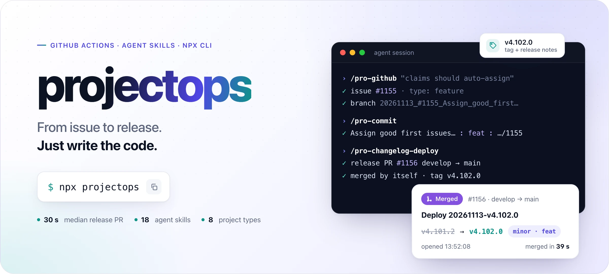
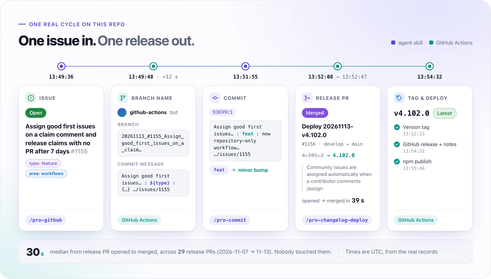
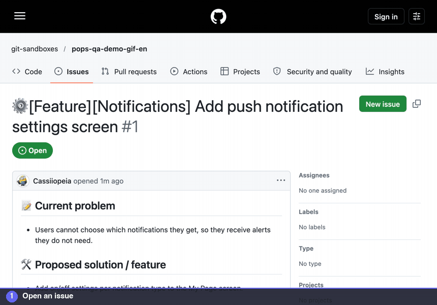
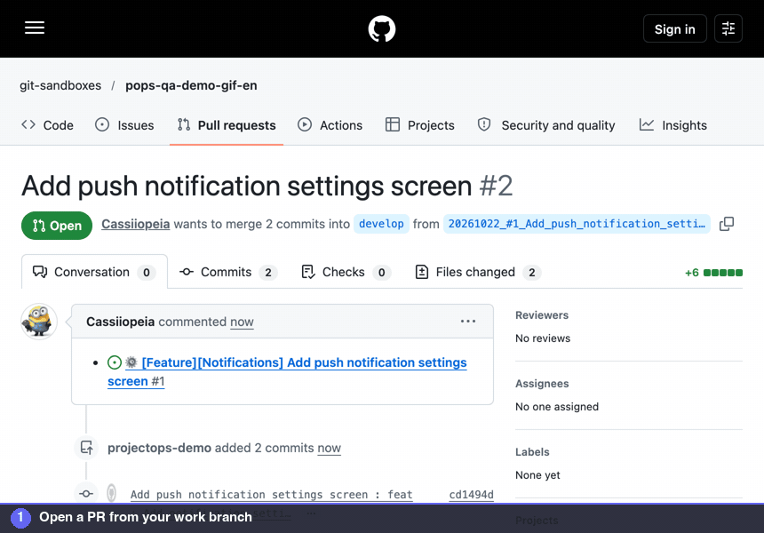
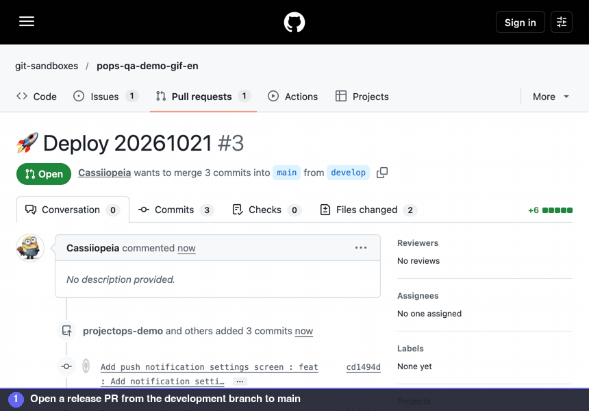
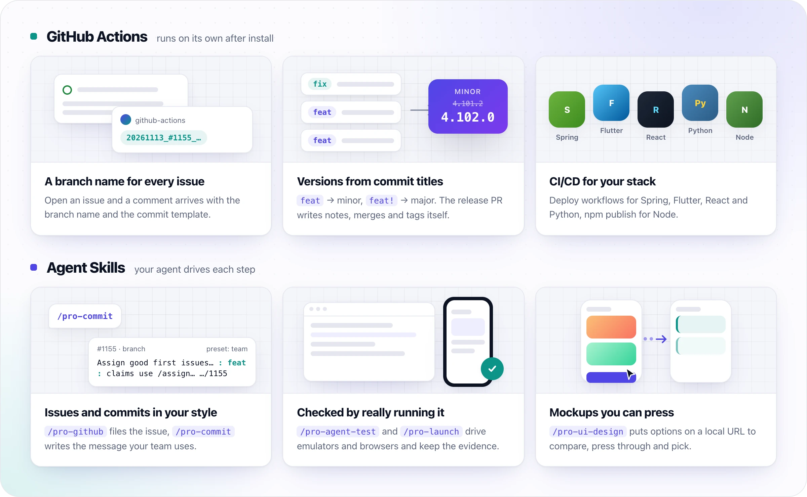
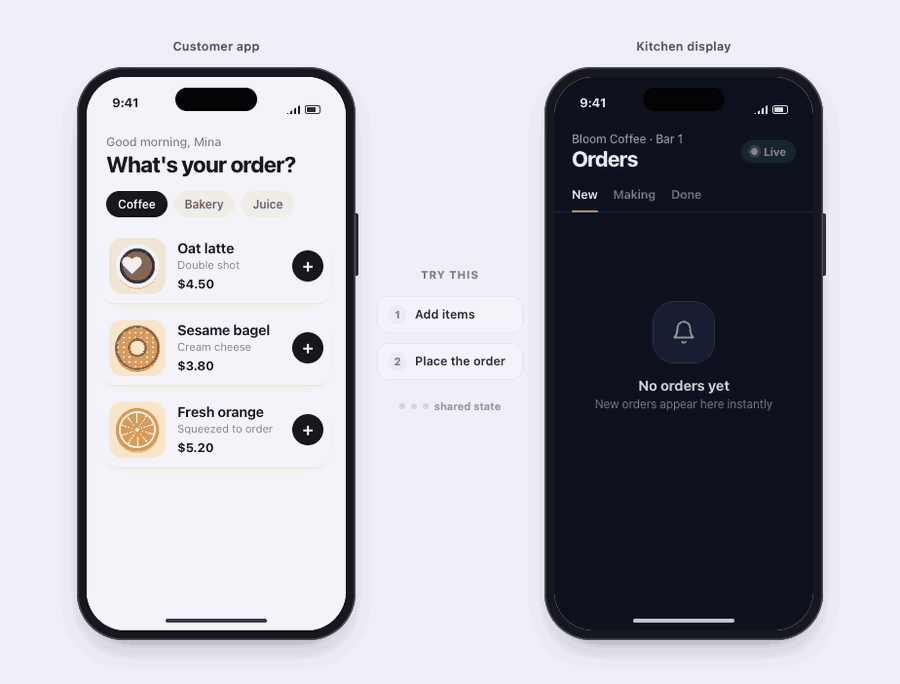
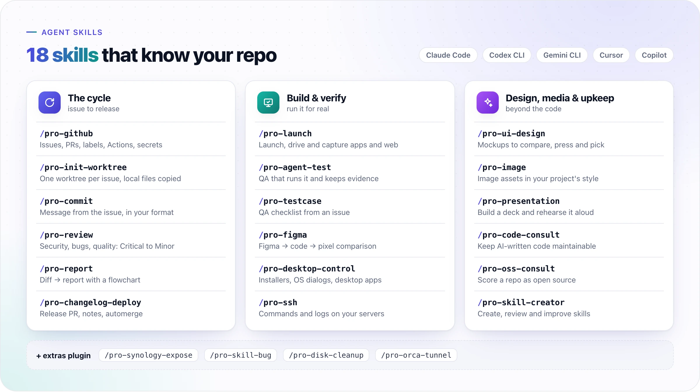

<div align="center">

<picture>
  <source media="(prefers-color-scheme: dark)" srcset="https://raw.githubusercontent.com/Cassiiopeia/projectops/main/docs/images/readme-hero-dark.webp">
  
</picture>

**One install: issue → branch → release PR → deploy, with agent skills that drive each step.**

[한국어](docs/i18n/README.ko.md) | **English** | [简体中文](docs/i18n/README.zh-CN.md) | [日本語](docs/i18n/README.ja.md)

[](https://www.npmjs.com/package/projectops) [](https://github.com/Cassiiopeia/projectops/releases) [](LICENSE) [](https://cassiiopeia.github.io/projectops/)

</div>

## Get started

```bash
npx projectops
```

| I want to... | Run this |
|---|---|
| Add it to an existing project | `npx projectops` (interactive wizard, nothing to install first) |
| Start a new project | Click **Use this template** on GitHub (set up in about a minute) |
| Install Agent Skills only | `npx projectops --mode skills` |
| Check the install state (read-only) | `npx projectops --mode doctor` |

Needs Node.js 20.12+ and Git (Agent Skills also need Python 3). npm `latest` is exactly what is on `main`. Every flag: [CLI reference](https://cassiiopeia.github.io/projectops/cli).

<details>
<summary>Watch the wizard run (real recording on a sample Spring project)</summary>


</details>

## How one change ships

<picture>
  <source media="(prefers-color-scheme: dark)" srcset="https://raw.githubusercontent.com/Cassiiopeia/projectops/main/docs/images/readme-cycle-dark.webp">
  
</picture>

Every card above is a real record from this repository. You open an issue (or `/pro-github` files it); a bot comments the branch name and commit template; `/pro-commit` writes the commit; `/pro-changelog-deploy` opens the release PR, which picks the version from commit titles (`feat` → minor), writes the notes, merges itself and tags the release.

**Measured on this repository.** The 29 release PRs opened from develop to main between 2026-11-07 and 2026-11-13 each went from opened to merged, with the version decided, CHANGELOG and README updated and the tag created, in a median of **30 seconds** (fastest 25, slowest 50). Nobody touched them after opening. Check it yourself: compare `created_at` and `merged_at` of the merged release PRs (`GET /repos/Cassiiopeia/projectops/pulls?state=closed&base=main`).

<details>
<summary>See it run: issue, PR summary and release, recorded in a sample repo (real time in the corner)</summary>

**Open an issue** and a comment with the branch name and commit template arrives.



**Open a PR** and a change summary built from the commits is posted, then updated on every push.



**Open a release PR** and it writes the notes, decides the version, merges and creates the tag.



</details>

## What you get

<picture>
  <source media="(prefers-color-scheme: dark)" srcset="https://raw.githubusercontent.com/Cassiiopeia/projectops/main/docs/images/readme-features-dark.webp">
  
</picture>

| The usual way | With projectops |
|---|---|
| Bump versions, tag and write the changelog by hand | The release PR decides the version from commit titles, writes the notes and tags |
| Set up CI/CD from scratch | Workflows for Spring, Flutter, React, Python and Node, ready on install |
| Format every issue and commit message by hand | `/pro-github` and `/pro-commit` write them in your team's format |
| Re-type prompts for every review or analysis | 18 skills give consistent results without re-typing |

**Mockups you can press.** `/pro-ui-design` puts options on a local URL in your repo's tokens and fonts. Here two screens share one state: the order placed on the left lands in the kitchen on the right. The same run can post this GIF to the issue.



## Agent Skills

<picture>
  <source media="(prefers-color-scheme: dark)" srcset="https://raw.githubusercontent.com/Cassiiopeia/projectops/main/docs/images/readme-skills-dark.webp">
  
</picture>

**Agent Skills** (18) run in Claude Code, Codex CLI, Gemini CLI, Cursor and GitHub Copilot, and write in your style (`~/.projectops/config/config.json`, see the [Skills guide](https://cassiiopeia.github.io/projectops/skills)). Design, planning and implementation are left to `superpowers` (brainstorming → writing-plans → executing-plans).

<details>
<summary>See all 18 Agent Skills and how to install them</summary>

| Group | Skill | Purpose |
|---|---|---|
| Cycle | `/pro-github` | Issues (one line → template), PRs, labels, comments, repo exploration, Actions and Secrets |
| Cycle | `/pro-init-worktree` | Create a Git worktree and copy the local files it needs |
| Cycle | `/pro-commit` | Commit message from the issue context, in your format (preset or template) |
| Cycle | `/pro-review` | Review from 6 angles, classified Critical / Major / Minor |
| Cycle | `/pro-report` | git diff → implementation report with a flowchart, posted as a comment |
| Cycle | `/pro-changelog-deploy` | Push develop → release PR to main + release notes + automerge |
| Build & verify | `/pro-launch` | Launch, drive and capture apps, web and servers; mock empty and error states |
| Build & verify | `/pro-agent-test` | QA that really runs the app and reports steps, evidence and severity |
| Build & verify | `/pro-testcase` | Issue → QA checklist |
| Build & verify | `/pro-figma` | Figma design → code, then a pixel comparison |
| Build & verify | `/pro-desktop-control` | Installer wizards, OS dialogs and desktop apps; asks before installs |
| Build & verify | `/pro-ssh` | Run commands on servers over SSH (EC2, Synology NAS, Linux) |
| Design & upkeep | `/pro-ui-design` | Mockups on a local URL to compare, press and pick, or a designer request |
| Design & upkeep | `/pro-image` | Image assets in your project's own style, with real transparency |
| Design & upkeep | `/pro-presentation` | Build an HTML deck, rehearse aloud with coaching, export PDF and PPT |
| Design & upkeep | `/pro-code-consult` | Keep AI-written code maintainable by your conventions |
| Design & upkeep | `/pro-oss-consult` | Score a repo as an open-source project and fix what you approve |
| Design & upkeep | `/pro-skill-creator` | Create, review and improve a skill |

**Extras** (optional plugin): `/pro-synology-expose`, `/pro-skill-bug` (report a suspected skill bug from any session), `/pro-disk-cleanup` (reclaim disk space safely), `/pro-orca-tunnel` (a public Orca Web URL on request). Install: `claude plugin install projectops-extras@projectops-marketplace --scope user`

```bash
# Claude Code
claude plugin marketplace add Cassiiopeia/projectops
claude plugin install projectops@projectops-marketplace --scope user
# Gemini CLI
gemini extensions install https://github.com/Cassiiopeia/projectops
# Codex CLI (macOS / Linux)
codex plugin marketplace add Cassiiopeia/projectops
# Cursor, GitHub Copilot and the full menu
npx projectops --mode skills
```

</details>

## Compared with other tools

If you only need one piece of this, a smaller tool may suit you better ([full comparison](https://cassiiopeia.github.io/projectops/compare)).

| | projectops | release-please | semantic-release | changesets |
|---|---|---|---|---|
| Version decided from | Commit titles | Conventional Commits | Conventional Commits | Changeset files |
| Release step | Release PR, merged automatically | Release PR you merge | Releases on push | "Version Packages" PR |
| CI/CD for your project type | Yes | No | No | No |
| Agent skills for the whole cycle | Yes | No | No | No |
| Adds to your repo | About 60 files | A workflow + config | A config + CI step | `.changeset/` + CI step |

## When it is not a fit

- **GitHub only.** It relies on GitHub Actions, issues and PRs.
- **Two branches.** Releases go from a development branch to the default branch (names are set in `version.yml`).
- **About 60 files** land in your repo (workflows, helper scripts, templates).
- **Frequent releases.** `latest` follows `main`; `npx projectops@<version>` pins the installer only, not the workflow templates.
- **Server deploys assume a Docker host reachable over SSH.** A personal access token is optional ([setup](https://cassiiopeia.github.io/projectops/getting-started)).

Supported types: `spring`, `flutter`, `react` (incl. Next.js), `node`, `python`, `react-native`, `react-native-expo`, `basic`. Comment commands such as `@projectops server build` and `@projectops build app`: [PR Preview](https://cassiiopeia.github.io/projectops/pr-preview), [Flutter builds](https://cassiiopeia.github.io/projectops/flutter-test-build-trigger), [Issue automation](https://cassiiopeia.github.io/projectops/issue-automation).

## Community

- **First contribution?** Pick a [`good first issue`](https://github.com/Cassiiopeia/projectops/issues?q=is%3Aissue+is%3Aopen+label%3A%22good+first+issue%22) and comment `/assign` on its own line; a bot assigns it to you for 7 days.
- [CONTRIBUTING.md](CONTRIBUTING.md) · [ARCHITECTURE.md](ARCHITECTURE.md) · [CODE_OF_CONDUCT.md](CODE_OF_CONDUCT.md) · [SECURITY.md](SECURITY.md) (report vulnerabilities privately)
- [Issues](https://github.com/Cassiiopeia/projectops/issues) for bugs and requests, [Discussions](https://github.com/Cassiiopeia/projectops/discussions) for questions. Finished issues get `status: done` and close when a release merges.

## Documentation

Everything is on the **[docs site](https://cassiiopeia.github.io/projectops/)**, in English and [Korean](https://cassiiopeia.github.io/projectops/ko/): [Getting started](https://cassiiopeia.github.io/projectops/getting-started) · [CLI](https://cassiiopeia.github.io/projectops/cli) · [Agent Skills](https://cassiiopeia.github.io/projectops/skills) · [Versioning](https://cassiiopeia.github.io/projectops/version-control) · [Changelog](https://cassiiopeia.github.io/projectops/changelog-automation) · [SSH + Docker deploy](https://cassiiopeia.github.io/projectops/ssh-docker-deployment-guide) · [Flutter CI/CD](https://cassiiopeia.github.io/projectops/flutter-cicd-overview) · [Troubleshooting](https://cassiiopeia.github.io/projectops/troubleshooting)

<!-- AUTO-VERSION-SECTION: DO NOT EDIT MANUALLY -->
## Latest version : v4.103.1 (2026-11-13)

[View full version history](CHANGELOG.md)

---

<div align="center">

**MIT License** · README images are rendered from [`docs/recording/readme_assets/`](docs/recording/readme_assets/)

</div>
