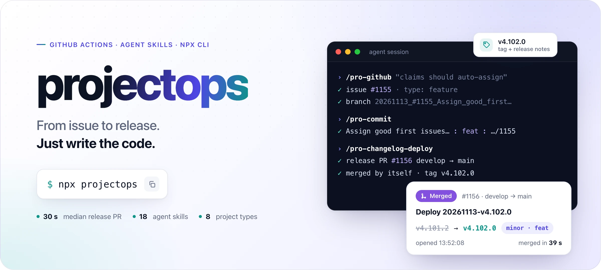
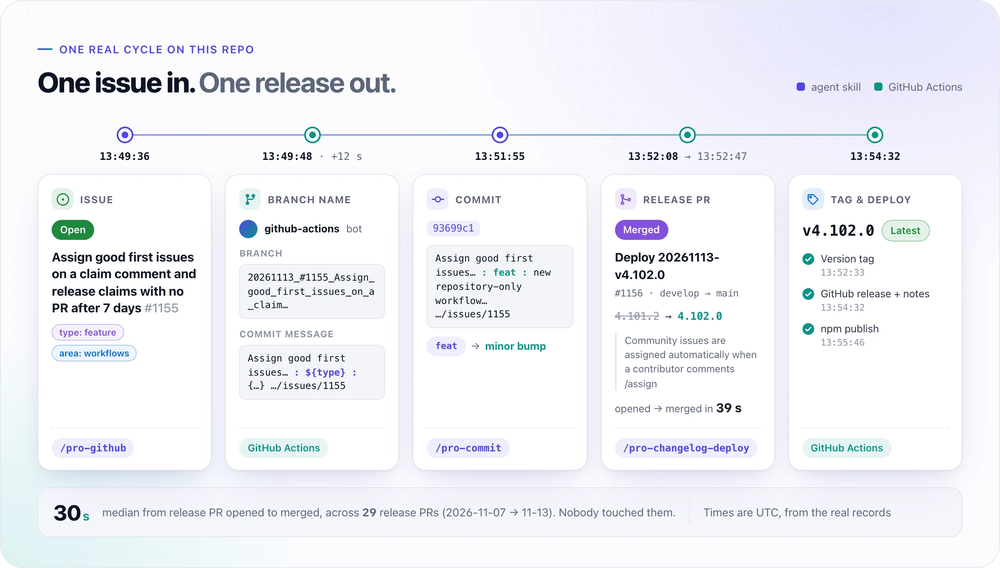
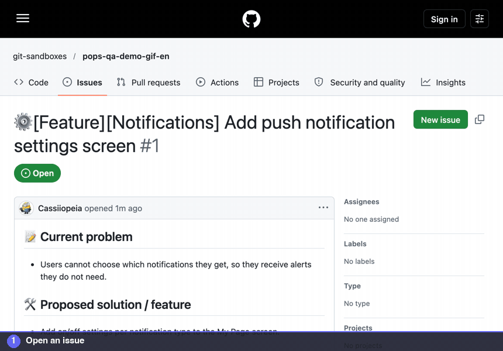
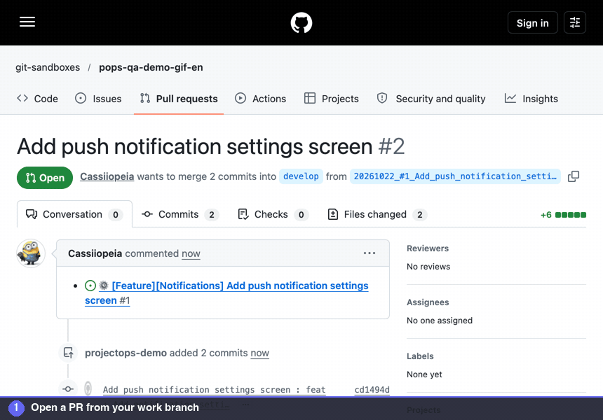
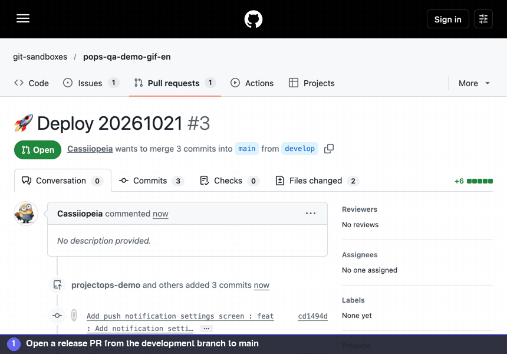
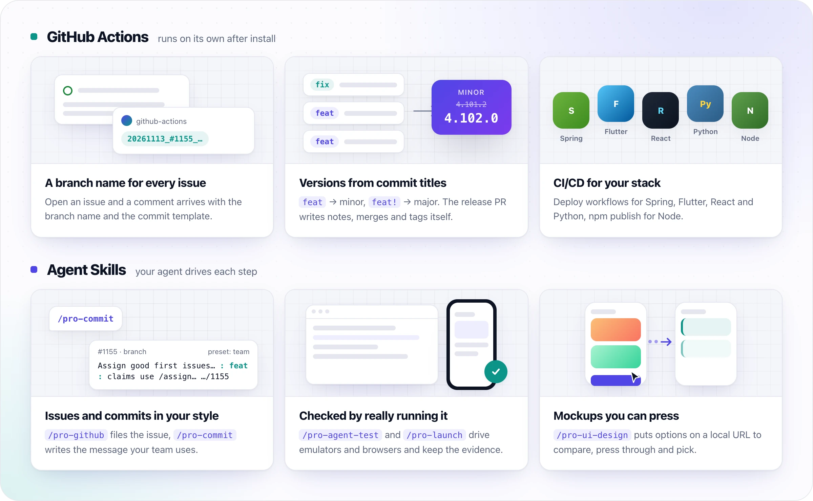
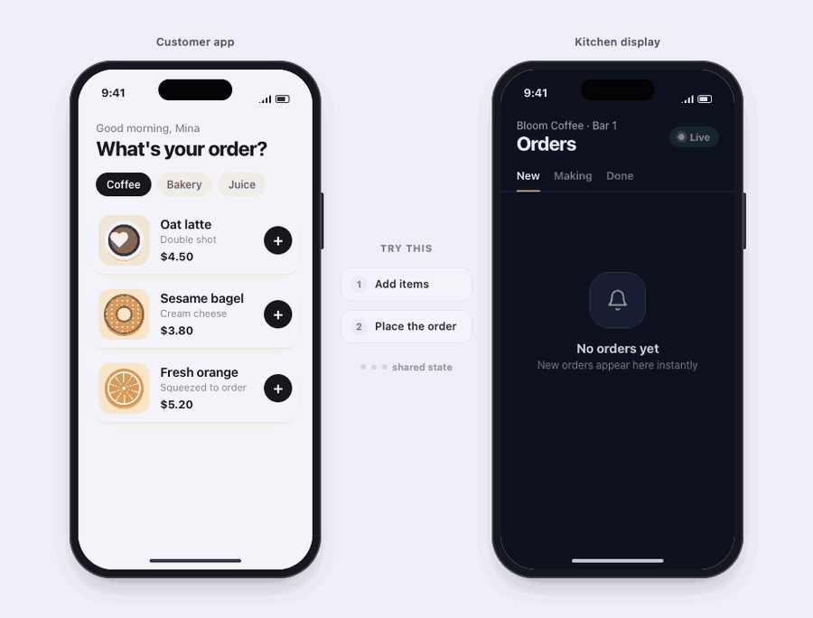
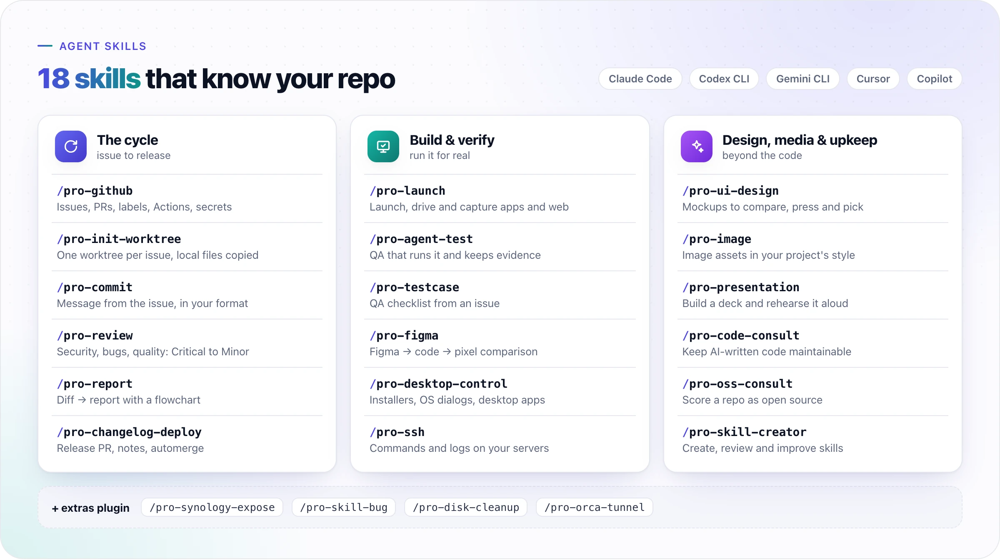

<!-- translated-from: README.md@ba95162a -->
<div align="center">

<picture>
  <source media="(prefers-color-scheme: dark)" srcset="https://raw.githubusercontent.com/Cassiiopeia/projectops/main/docs/images/readme-hero-dark.webp">
  
</picture>

**一度のインストールで Issue → ブランチ → リリース PR → デプロイまで、各ステップをエージェントスキルが動かします。**

[한국어](README.ko.md) | [English](../../README.md) | [简体中文](README.zh-CN.md) | **日本語**

[](https://www.npmjs.com/package/projectops) [](https://github.com/Cassiiopeia/projectops/releases) [](../../LICENSE) [](https://cassiiopeia.github.io/projectops/)

</div>

## はじめる

```bash
npx projectops
```

| やりたいこと | 実行するもの |
|---|---|
| 既存のプロジェクトに追加する | `npx projectops`（対話型ウィザード、事前インストール不要） |
| 新しいプロジェクトを始める | GitHub で **Use this template** をクリック（約 1 分で自動セットアップ） |
| Agent Skills だけをインストールする | `npx projectops --mode skills` |
| インストール状態を確認する（読み取り専用） | `npx projectops --mode doctor` |

Node.js 20.12 以上と Git が必要です（Agent Skills には Python 3 も必要）。npm の `latest` は `main` ブランチと完全に同じです。すべてのオプション：[CLI リファレンス](https://cassiiopeia.github.io/projectops/cli)（英語）。

<details>
<summary>ウィザードの動きを見る（サンプル Spring プロジェクトでの実録）</summary>


</details>

## 1 つの変更がリリースされるまで

<picture>
  <source media="(prefers-color-scheme: dark)" srcset="https://raw.githubusercontent.com/Cassiiopeia/projectops/main/docs/images/readme-cycle-dark.webp">
  
</picture>

上のカードはすべてこのリポジトリの実際の記録です。Issue を開く（または `/pro-github` が登録する）と、ボットがブランチ名とコミットテンプレートをコメントし、`/pro-commit` がコミットを書き、`/pro-changelog-deploy` がリリース PR を開きます。リリース PR はコミットタイトルからバージョンを決め（`feat` → minor）、ノートを書き、自分でマージしてタグを作ります。

**このリポジトリで計測しました。** 2026-11-07 から 2026-11-13 に develop から main へ開かれたリリース PR 29 件は、開いてからバージョン決定、CHANGELOG・README 更新、タグ作成を終えてマージされるまで中央値 **30 秒**でした（最速 25 秒、最遅 50 秒）。開いた後は誰も触っていません。確認方法：マージ済みリリース PR の `created_at` と `merged_at` を比べてください（`GET /repos/Cassiiopeia/projectops/pulls?state=closed&base=main`）。

<details>
<summary>実際の動き：Issue、PR 要約、リリース（サンプルリポジトリで録画、隅の時計は実時間）</summary>

**Issue を開く**と、ブランチ名とコミットテンプレートのコメントが付きます。



**PR を開く**と、コミットから作った変更要約が投稿され、push のたびに同じコメントが更新されます。



**リリース PR を開く**と、ノート作成、バージョン決定、マージ、タグ作成まで進みます。



</details>

## 得られるもの

<picture>
  <source media="(prefers-color-scheme: dark)" srcset="https://raw.githubusercontent.com/Cassiiopeia/projectops/main/docs/images/readme-features-dark.webp">
  
</picture>

| これまでのやり方 | projectops |
|---|---|
| バージョン・タグ・変更履歴を手作業で | リリース PR がコミットタイトルからバージョンを決め、ノートとタグまで作る |
| CI/CD をゼロから構築 | Spring・Flutter・React・Python・Node のワークフローをインストール直後から利用 |
| Issue とコミットメッセージを毎回手で整える | `/pro-github` と `/pro-commit` がチームの形式で書く |
| コードレビューや分析のたびにプロンプトを入力 | 18 種の Skills で一貫した結果。毎回の再入力は不要 |

**押せるモックアップ。** `/pro-ui-design` はリポジトリのトークンとフォントで作ったモックアップをローカル URL に表示します。下の例では 2 つの画面が 1 つの状態を共有し、左で注文すると右のキッチン画面に届きます。同じ実行でこの GIF を Issue に投稿することもできます。



## Agent Skills

<picture>
  <source media="(prefers-color-scheme: dark)" srcset="https://raw.githubusercontent.com/Cassiiopeia/projectops/main/docs/images/readme-skills-dark.webp">
  
</picture>

**Agent Skills**（18 種）は Claude Code、Codex CLI、Gemini CLI、Cursor、GitHub Copilot で動き、あなたのスタイルで書きます（`~/.projectops/config/config.json`、[Skills ガイド](https://cassiiopeia.github.io/projectops/skills)（英語）を参照）。設計・計画・実装は `superpowers`（brainstorming → writing-plans → executing-plans）が担当します。

<details>
<summary>Agent Skills 全 18 種とインストール方法を見る</summary>

| グループ | スキル | 用途 |
|---|---|---|
| サイクル | `/pro-github` | Issue（1 行 → テンプレート）、PR、ラベル、コメント、リポジトリ探索、Actions、Secret |
| サイクル | `/pro-init-worktree` | Git worktree を作成し、必要なローカルファイルをコピー |
| サイクル | `/pro-commit` | Issue の文脈から自分の形式でコミットメッセージを完成（プリセットまたはテンプレート） |
| サイクル | `/pro-review` | 6 つの観点でレビューし、Critical / Major / Minor に分類 |
| サイクル | `/pro-report` | git diff → フローチャート付き実装レポートをコメントで投稿 |
| サイクル | `/pro-changelog-deploy` | develop を push → main へのリリース PR + リリースノート + 自動マージ |
| 構築と検証 | `/pro-launch` | アプリ・Web・サーバーの起動、操作、キャプチャ。空リストや失敗応答も再現 |
| 構築と検証 | `/pro-agent-test` | 実際に動かす QA。再現手順・証拠・重大度を報告 |
| 構築と検証 | `/pro-testcase` | Issue → QA チェックリスト |
| 構築と検証 | `/pro-figma` | Figma デザイン → コード → ピクセル比較 |
| 構築と検証 | `/pro-desktop-control` | インストーラー、OS ダイアログ、デスクトップアプリの操作。インストール前に確認 |
| 構築と検証 | `/pro-ssh` | SSH でサーバーのコマンドを実行（EC2、Synology NAS、Linux） |
| デザインと保守 | `/pro-ui-design` | ローカル URL で比較・操作・選択できるモックアップ、デザイナーへの依頼書 |
| デザインと保守 | `/pro-image` | プロジェクトの画風に合った画像アセット、本物の透過 |
| デザインと保守 | `/pro-presentation` | HTML 発表資料の作成、声に出すリハーサルのコーチング、PDF・PPT 出力 |
| デザインと保守 | `/pro-code-consult` | AI が書いたコードを自分のコーディング規約で保守しやすく |
| デザインと保守 | `/pro-oss-consult` | オープンソースとしてリポジトリを採点し、承認したものだけ修正 |
| デザインと保守 | `/pro-skill-creator` | スキルの作成・レビュー・改善 |

**Extras**（任意のプラグイン）：`/pro-synology-expose`、`/pro-skill-bug`（どのセッションからでもスキルのバグを報告）、`/pro-disk-cleanup`（ディスク容量を安全に整理）、`/pro-orca-tunnel`（Orca Web の公開 URL を発行）。インストール：`claude plugin install projectops-extras@projectops-marketplace --scope user`

```bash
# Claude Code
claude plugin marketplace add Cassiiopeia/projectops
claude plugin install projectops@projectops-marketplace --scope user
# Gemini CLI
gemini extensions install https://github.com/Cassiiopeia/projectops
# Codex CLI (macOS / Linux)
codex plugin marketplace add Cassiiopeia/projectops
# Cursor、GitHub Copilot、フルメニュー
npx projectops --mode skills
```

</details>

## 他のツールとの比較

一部だけが必要なら、より小さなツールのほうが合うかもしれません（[全体の比較](https://cassiiopeia.github.io/projectops/compare)、英語）。

| | projectops | release-please | semantic-release | changesets |
|---|---|---|---|---|
| バージョンの決め方 | コミットタイトル | Conventional Commits | Conventional Commits | changeset ファイル |
| リリースの手順 | リリース PR、自動マージ | 自分でマージするリリース PR | push でリリース | "Version Packages" PR |
| プロジェクト種別ごとの CI/CD | あり | なし | なし | なし |
| サイクル全体を回すエージェントスキル | あり | なし | なし | なし |
| リポジトリに追加されるもの | 約 60 ファイル | ワークフロー + 設定 | 設定 + CI ステップ | `.changeset/` + CI ステップ |

## 合わないケース

- **GitHub 専用。** GitHub Actions と Issue・PR が前提です。
- **2 つのブランチ。** リリースは開発ブランチからデフォルトブランチへ進みます（名前は `version.yml` で変更）。
- **約 60 ファイル**がリポジトリに追加されます（ワークフロー、補助スクリプト、テンプレート）。
- **リリースが頻繁です。** `latest` は `main` に追従します。`npx projectops@<version>` が固定するのはインストーラーだけで、ワークフローテンプレートは固定されません。
- **サーバーデプロイは SSH で接続できる Docker ホストを前提とします。** 個人アクセストークンは任意です（[設定](https://cassiiopeia.github.io/projectops/getting-started)）。

対応タイプ：`spring`、`flutter`、`react`（Next.js を含む）、`node`、`python`、`react-native`、`react-native-expo`、`basic`。`@projectops server build`、`@projectops build app` などのコメントコマンド：[PR Preview](https://cassiiopeia.github.io/projectops/pr-preview)、[Flutter ビルド](https://cassiiopeia.github.io/projectops/flutter-test-build-trigger)、[Issue 自動化](https://cassiiopeia.github.io/projectops/issue-automation)。

## コミュニティ

- **初めての貢献なら** [`good first issue`](https://github.com/Cassiiopeia/projectops/issues?q=is%3Aissue+is%3Aopen+label%3A%22good+first+issue%22) を選び、`/assign` だけを 1 行でコメントすると、ボットが 7 日間あなたを担当者にします。
- [CONTRIBUTING.md](../../CONTRIBUTING.md) · [ARCHITECTURE.md](../../ARCHITECTURE.md) · [CODE_OF_CONDUCT.md](../../CODE_OF_CONDUCT.md) · [SECURITY.md](../../SECURITY.md)（脆弱性は非公開で報告）
- バグや要望は [Issues](https://github.com/Cassiiopeia/projectops/issues)、質問は [Discussions](https://github.com/Cassiiopeia/projectops/discussions) へ。完了した Issue には `status: done` が付き、リリースのマージ時に閉じられます。

## ドキュメント

すべて **[ドキュメントサイト](https://cassiiopeia.github.io/projectops/)**（英語・韓国語）にあります：[はじめに](https://cassiiopeia.github.io/projectops/getting-started) · [CLI](https://cassiiopeia.github.io/projectops/cli) · [Agent Skills](https://cassiiopeia.github.io/projectops/skills) · [バージョン管理](https://cassiiopeia.github.io/projectops/version-control) · [変更履歴](https://cassiiopeia.github.io/projectops/changelog-automation) · [SSH + Docker デプロイ](https://cassiiopeia.github.io/projectops/ssh-docker-deployment-guide) · [Flutter CI/CD](https://cassiiopeia.github.io/projectops/flutter-cicd-overview) · [トラブルシューティング](https://cassiiopeia.github.io/projectops/troubleshooting)

全バージョン履歴：[CHANGELOG.md](../../CHANGELOG.md)

---

<div align="center">

**MIT License** · README の画像は [`docs/recording/readme_assets/`](../recording/readme_assets/) からレンダリングしています

</div>
