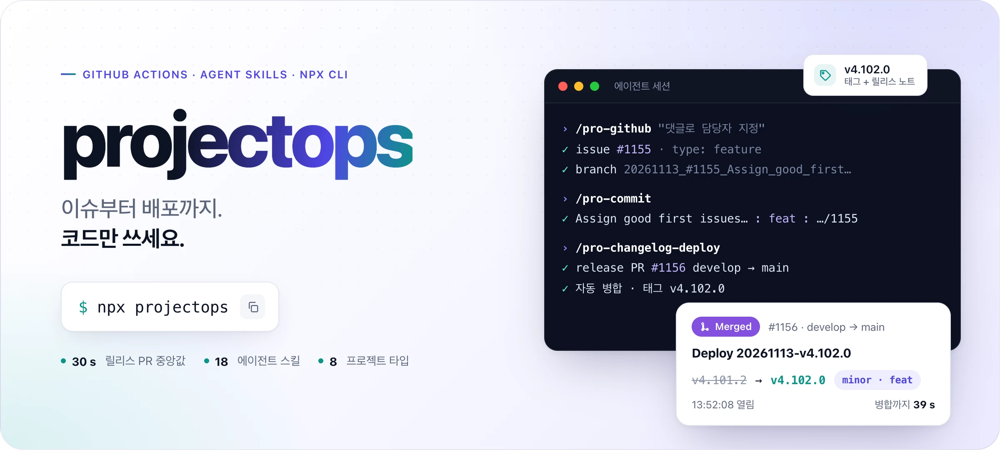
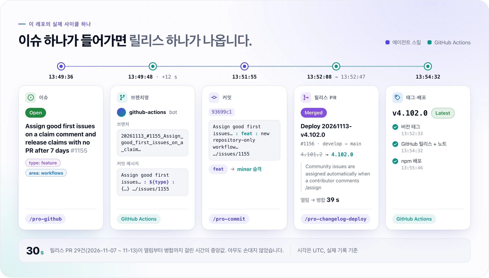
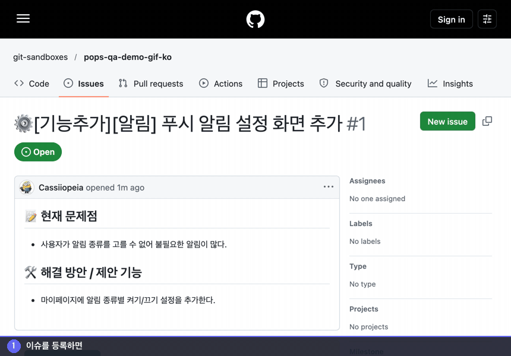
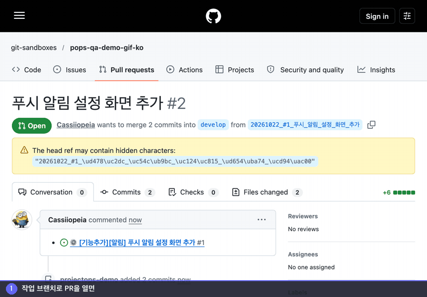
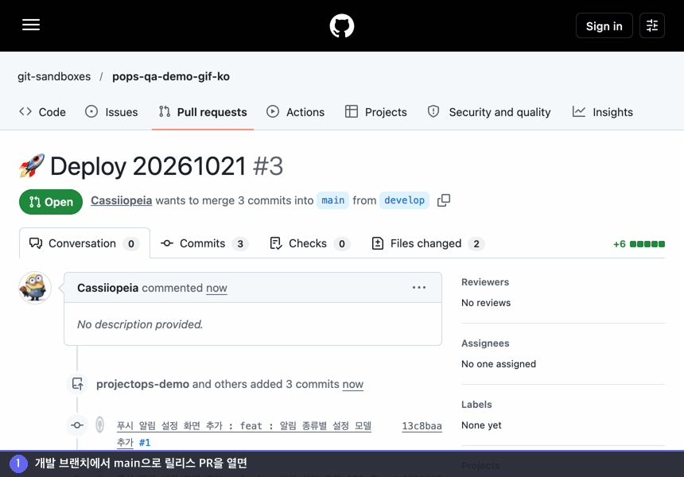
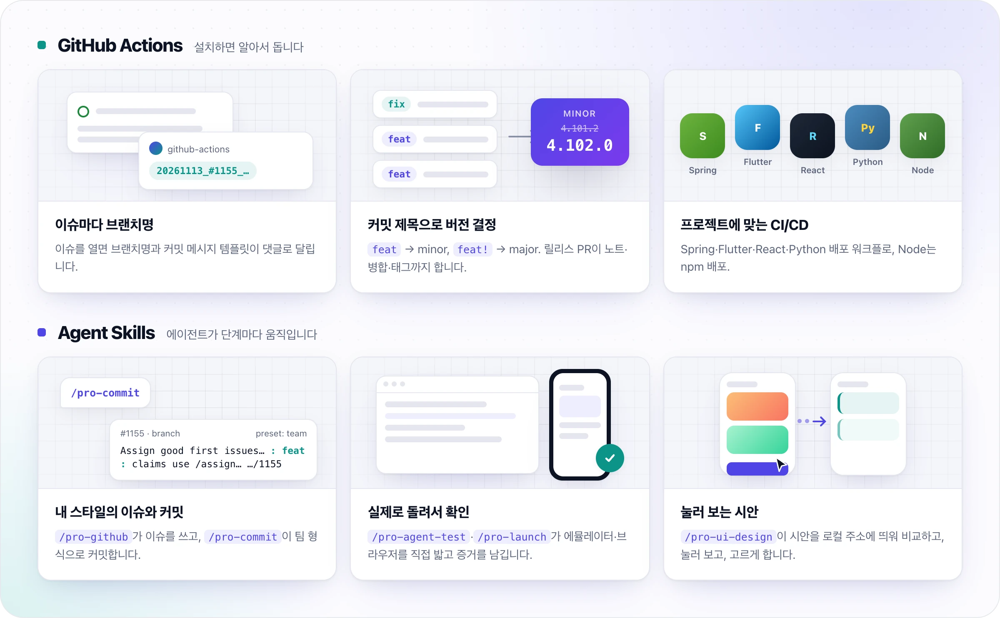
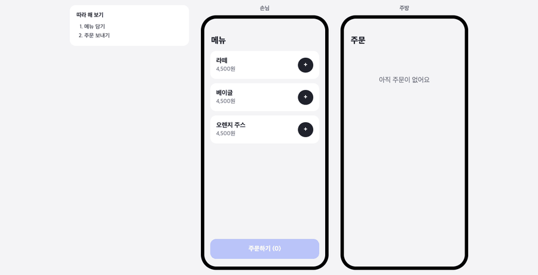
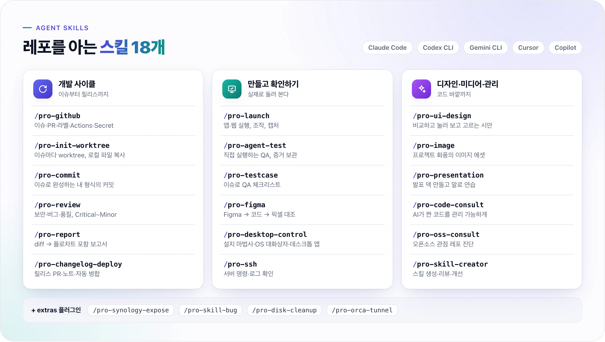

<!-- translated-from: README.md@ba95162a -->
<div align="center">

<picture>
  <source media="(prefers-color-scheme: dark)" srcset="https://raw.githubusercontent.com/Cassiiopeia/projectops/main/docs/images/readme-hero-dark.ko.webp">
  
</picture>

**설치 한 번으로 이슈 → 브랜치 → 릴리스 PR → 배포까지, 단계마다 에이전트 스킬이 함께 움직입니다.**

**한국어** | [English](../../README.md) | [简体中文](README.zh-CN.md) | [日本語](README.ja.md)

[](https://www.npmjs.com/package/projectops) [](https://github.com/Cassiiopeia/projectops/releases) [](../../LICENSE) [](https://cassiiopeia.github.io/projectops/ko/)

</div>

## 시작하기

```bash
npx projectops
```

| 하고 싶은 것 | 실행 |
|---|---|
| 기존 프로젝트에 넣기 | `npx projectops` (대화형 마법사, 따로 설치할 것 없음) |
| 새 프로젝트 시작 | GitHub에서 **Use this template** 클릭 (1분 안팎 자동 설정) |
| Agent Skills만 설치 | `npx projectops --mode skills` |
| 설치 상태 점검 (읽기 전용) | `npx projectops --mode doctor` |

Node.js 20.12 이상과 Git이 필요합니다 (Agent Skills는 Python 3도 필요). npm `latest`는 `main` 브랜치와 정확히 같습니다. 모든 옵션: [CLI 레퍼런스](https://cassiiopeia.github.io/projectops/ko/cli).

<details>
<summary>마법사가 도는 모습 보기 (예시 Spring 프로젝트 실제 녹화)</summary>


</details>

## 변경 하나가 배포되기까지

<picture>
  <source media="(prefers-color-scheme: dark)" srcset="https://raw.githubusercontent.com/Cassiiopeia/projectops/main/docs/images/readme-cycle-dark.ko.webp">
  
</picture>

위 카드는 모두 이 레포의 실제 기록입니다. 이슈를 열면(또는 `/pro-github`가 등록하면) 봇이 브랜치명과 커밋 템플릿을 댓글로 달고, `/pro-commit`이 커밋을 쓰고, `/pro-changelog-deploy`가 릴리스 PR을 엽니다. 릴리스 PR은 커밋 제목으로 버전을 정하고(`feat` → minor) 노트를 쓴 뒤 스스로 병합하고 태그를 만듭니다.

**이 레포에서 측정했습니다.** 2026-11-07 ~ 2026-11-13에 develop → main으로 열린 릴리스 PR 29건은 열린 뒤 버전 결정, CHANGELOG·README 갱신, 태그 생성까지 마치고 병합되는 데 중앙값 **30초**가 걸렸습니다 (가장 빠른 것 25초, 가장 느린 것 50초). 연 뒤로 아무도 손대지 않았습니다. 직접 확인: 병합된 릴리스 PR의 `created_at`과 `merged_at`을 비교하세요 (`GET /repos/Cassiiopeia/projectops/pulls?state=closed&base=main`).

<details>
<summary>실제로 도는 모습: 이슈, PR 요약, 릴리스 (예시 레포 녹화, 모서리 시계는 실제 시간)</summary>

**이슈를 열면** 브랜치명과 커밋 템플릿이 담긴 댓글이 달립니다.



**PR을 열면** 커밋으로 만든 변경 요약이 달리고, 푸시할 때마다 같은 댓글이 갱신됩니다.



**릴리스 PR을 열면** 노트 작성, 버전 결정, 병합, 태그 생성까지 진행됩니다.



</details>

## 무엇을 얻나요

<picture>
  <source media="(prefers-color-scheme: dark)" srcset="https://raw.githubusercontent.com/Cassiiopeia/projectops/main/docs/images/readme-features-dark.ko.webp">
  
</picture>

| 기존 방식 | projectops |
|---|---|
| 버전 올리기·태그·체인지로그를 손으로 | 릴리스 PR이 커밋 제목으로 버전을 정하고 노트를 쓰고 태그까지 |
| CI/CD를 처음부터 구성 | Spring·Flutter·React·Python·Node 워크플로가 설치 즉시 준비 |
| 이슈와 커밋 메시지를 매번 형식에 맞춰 작성 | `/pro-github`·`/pro-commit`이 팀 형식으로 작성 |
| 코드 리뷰·분석 매번 프롬프트 입력 | 18종 Skills로 일관된 결과, 매번 재입력 불필요 |

**눌러 보는 시안.** `/pro-ui-design`은 레포의 토큰과 글꼴로 만든 시안을 로컬 주소에 띄웁니다. 아래는 두 화면이 상태 하나를 공유하는 예시로, 왼쪽에서 주문하면 오른쪽 주방 화면에 바로 뜹니다. 같은 실행에서 이 GIF를 이슈에 올릴 수도 있습니다.



## Agent Skills

<picture>
  <source media="(prefers-color-scheme: dark)" srcset="https://raw.githubusercontent.com/Cassiiopeia/projectops/main/docs/images/readme-skills-dark.ko.webp">
  
</picture>

**Agent Skills** (18종)는 Claude Code, Codex CLI, Gemini CLI, Cursor, GitHub Copilot에서 동작하고 내 스타일로 씁니다 (`~/.projectops/config/config.json`, [Skills 가이드](https://cassiiopeia.github.io/projectops/ko/skills) 참고). 설계·계획·구현은 `superpowers`(brainstorming → writing-plans → executing-plans)가 맡습니다.

<details>
<summary>Agent Skills 18종 전체와 설치 방법 보기</summary>

| 묶음 | 스킬 | 용도 |
|---|---|---|
| 사이클 | `/pro-github` | 이슈(한 줄 → 템플릿)·PR·라벨·댓글·레포 탐색·Actions·Secret |
| 사이클 | `/pro-init-worktree` | Git worktree 생성 + 필요한 로컬 파일 복사 |
| 사이클 | `/pro-commit` | 이슈 맥락으로 내 형식의 커밋 메시지 완성 (프리셋 또는 템플릿) |
| 사이클 | `/pro-review` | 6가지 관점 리뷰, Critical / Major / Minor 분류 |
| 사이클 | `/pro-report` | git diff → 플로차트 포함 구현 보고서, 댓글로 게시 |
| 사이클 | `/pro-changelog-deploy` | develop 푸시 → main 릴리스 PR + 릴리스 노트 + 자동 병합 |
| 만들고 확인 | `/pro-launch` | 앱·웹·서버 실행·조작·캡처, 빈 목록·실패 응답 흉내 |
| 만들고 확인 | `/pro-agent-test` | 실제로 돌리는 QA, 재현 절차·증거·심각도 보고 |
| 만들고 확인 | `/pro-testcase` | 이슈 → QA 체크리스트 |
| 만들고 확인 | `/pro-figma` | Figma 시안 → 코드 → 픽셀 대조 |
| 만들고 확인 | `/pro-desktop-control` | 설치 마법사·OS 대화상자·데스크톱 앱 조작, 설치 전 확인 |
| 만들고 확인 | `/pro-ssh` | SSH로 서버 명령 실행 (EC2, 시놀로지 NAS, Linux) |
| 디자인·관리 | `/pro-ui-design` | 로컬 주소에서 비교하고 눌러 보고 고르는 시안, 디자이너 요청서 |
| 디자인·관리 | `/pro-image` | 프로젝트 화풍의 이미지 에셋, 진짜 투명 배경 |
| 디자인·관리 | `/pro-presentation` | HTML 발표 덱 제작, 말로 연습 코칭, PDF·PPT 내보내기 |
| 디자인·관리 | `/pro-code-consult` | AI가 짠 코드를 내 코딩 규칙으로 관리 |
| 디자인·관리 | `/pro-oss-consult` | 오픈소스 관점으로 레포 채점, 승인한 것만 수정 |
| 디자인·관리 | `/pro-skill-creator` | 스킬 생성·리뷰·개선 |

**Extras** (선택 플러그인): `/pro-synology-expose`, `/pro-skill-bug` (어느 세션에서든 스킬 버그 의심 보고), `/pro-disk-cleanup` (디스크 용량 안전 정리), `/pro-orca-tunnel` (요청 시 Orca Web 공개 주소). 설치: `claude plugin install projectops-extras@projectops-marketplace --scope user`

```bash
# Claude Code
claude plugin marketplace add Cassiiopeia/projectops
claude plugin install projectops@projectops-marketplace --scope user
# Gemini CLI
gemini extensions install https://github.com/Cassiiopeia/projectops
# Codex CLI (macOS / Linux)
codex plugin marketplace add Cassiiopeia/projectops
# Cursor, GitHub Copilot, 전체 메뉴
npx projectops --mode skills
```

</details>

## 다른 도구와 비교

이 중 한 조각만 필요하다면 더 작은 도구가 나을 수 있습니다 ([전체 비교](https://cassiiopeia.github.io/projectops/ko/compare)).

| | projectops | release-please | semantic-release | changesets |
|---|---|---|---|---|
| 버전 결정 기준 | 커밋 제목 | Conventional Commits | Conventional Commits | changeset 파일 |
| 릴리스 단계 | 릴리스 PR, 자동 병합 | 직접 병합하는 릴리스 PR | 푸시하면 릴리스 | "Version Packages" PR |
| 프로젝트 타입별 CI/CD | 있음 | 없음 | 없음 | 없음 |
| 사이클 전체를 돌리는 에이전트 스킬 | 있음 | 없음 | 없음 | 없음 |
| 레포에 추가되는 것 | 약 60개 파일 | 워크플로 + 설정 | 설정 + CI 단계 | `.changeset/` + CI 단계 |

## 맞지 않는 경우

- **GitHub 전용.** GitHub Actions와 이슈·PR을 전제로 합니다.
- **브랜치 두 개.** 릴리스는 개발 브랜치에서 기본 브랜치로 갑니다 (이름은 `version.yml`에서 바꿈).
- **약 60개 파일**이 레포에 추가됩니다 (워크플로, 보조 스크립트, 템플릿).
- **릴리스가 잦습니다.** `latest`는 `main`을 따릅니다. `npx projectops@<버전>`은 설치 도구만 고정하고 워크플로 템플릿은 고정하지 않습니다.
- **서버 배포는 SSH로 접속되는 Docker 호스트를 가정합니다.** 개인 액세스 토큰은 선택입니다 ([설정](https://cassiiopeia.github.io/projectops/ko/getting-started)).

지원 타입: `spring`, `flutter`, `react` (Next.js 포함), `node`, `python`, `react-native`, `react-native-expo`, `basic`. `@projectops server build`, `@projectops build app` 같은 댓글 명령: [PR Preview](https://cassiiopeia.github.io/projectops/ko/pr-preview), [Flutter 빌드](https://cassiiopeia.github.io/projectops/ko/flutter-test-build-trigger), [이슈 자동화](https://cassiiopeia.github.io/projectops/ko/issue-automation).

## 커뮤니티

- **첫 기여라면** [`good first issue`](https://github.com/Cassiiopeia/projectops/issues?q=is%3Aissue+is%3Aopen+label%3A%22good+first+issue%22)를 골라 `/assign`만 한 줄로 댓글 달면 봇이 7일 동안 담당자로 지정합니다.
- [CONTRIBUTING.md](../../CONTRIBUTING.md) · [ARCHITECTURE.md](../../ARCHITECTURE.md) · [CODE_OF_CONDUCT.md](../../CODE_OF_CONDUCT.md) · [SECURITY.md](../../SECURITY.md) (보안 취약점은 비공개로 제보)
- 버그·요청은 [Issues](https://github.com/Cassiiopeia/projectops/issues), 질문은 [Discussions](https://github.com/Cassiiopeia/projectops/discussions). 끝난 이슈는 `status: done` 라벨이 붙고 릴리스가 병합될 때 닫힙니다.

## 문서

모든 내용은 **[문서 사이트](https://cassiiopeia.github.io/projectops/ko/)**에 있습니다: [시작하기](https://cassiiopeia.github.io/projectops/ko/getting-started) · [CLI](https://cassiiopeia.github.io/projectops/ko/cli) · [Agent Skills](https://cassiiopeia.github.io/projectops/ko/skills) · [버전 관리](https://cassiiopeia.github.io/projectops/ko/version-control) · [체인지로그](https://cassiiopeia.github.io/projectops/ko/changelog-automation) · [SSH + Docker 배포](https://cassiiopeia.github.io/projectops/ko/ssh-docker-deployment-guide) · [Flutter CI/CD](https://cassiiopeia.github.io/projectops/ko/flutter-cicd-overview) · [문제 해결](https://cassiiopeia.github.io/projectops/ko/troubleshooting)

전체 버전 기록: [CHANGELOG.md](../../CHANGELOG.md)

---

<div align="center">

**MIT License** · README 이미지는 [`docs/recording/readme_assets/`](../recording/readme_assets/)에서 렌더링합니다

</div>
