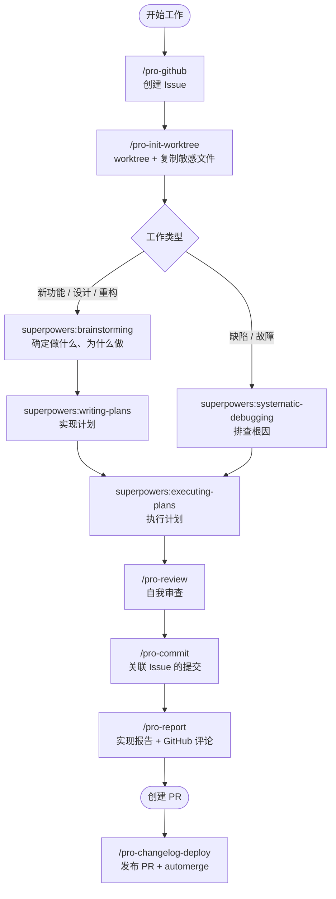
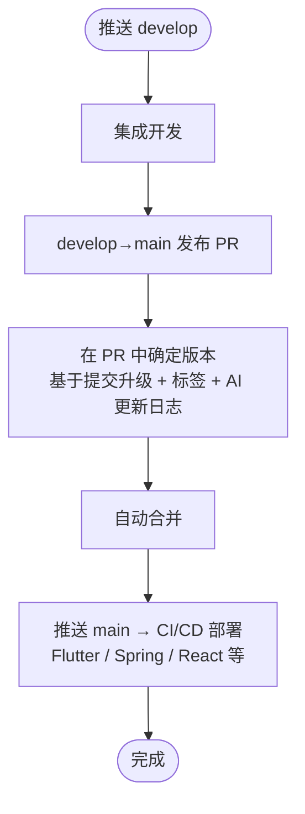

<div align="center">


**一次安装，从 Issue → 分支 → 发布 PR → 部署，每一步都有 Agent Skills 配合驱动。**

[한국어](README.ko.md) | [English](../../README.md) | **简体中文** | [日本語](README.ja.md)

[](https://www.npmjs.com/package/projectops) [](https://github.com/Cassiiopeia/projectops/releases) [](../../LICENSE) [](https://cassiiopeia.github.io/projectops/)

</div>

---

## 30 秒开始

| 我想要… | 执行这个 |
|---|---|
| 开始一个新项目 | 在 GitHub 上点击 **Use this template**（约 1 分钟自动完成初始化） |
| 集成到现有项目 | `npx projectops` |
| 仅安装 Agent Skills | `npx projectops --mode skills` |
| 检查安装状态（只读） | `npx projectops --mode doctor` |

> 只需 Node.js 20.12+，无需单独安装即可运行交互式向导。


> 以上是在示例 Spring 项目上的**真实运行画面**（向导跟随系统语言，也可用 `--lang en|ko` 指定）。画面中的版本号以录制时为准。非交互式用法和全部选项请见 [CLI 参考](https://cassiiopeia.github.io/projectops/cli)（英文）。

---

## 为什么选择这个模板？

本项目从两个方向自动化开发工作流。

**① GitHub Actions**：推送一次 main，版本管理、更新日志、CI/CD 部署全部自动完成。
**② Agent Skills**：通过 `/pro-github`、`/pro-commit`、`/pro-report` 等命令，由 AI 代你推进这套自动化的每一步：Issue、你自己风格的提交、报告和发布 PR。

| 传统做法 | 使用 Projectops |
|----------|---------------------|
| 手动管理版本、手动创建标签 | 发布时按提交标题自动升级版本并创建标签 |
| 手写更新日志 | 每个发布 PR 自动生成（提交分析；配置 AI 密钥后为 AI 摘要） |
| 从零搭建 CI/CD | 立即按项目类型配置好工作流 |
| 每次按格式手写 Issue | `/pro-github` 一步按标准模板生成并提交 |
| 手动把 Issue 链接复制到提交信息 | `/pro-commit` 根据 Issue 上下文，按你自己的格式自动补全 |
| 手写 PR 说明和报告 | `/pro-report` 分析 git diff 后自动生成 |
| 每次代码审查和分析都要重新输入提示词 | 15 个 Skills 提供一致的结果，无需重复输入 |

---

## 与其他工具的比较

如果你只需要其中一部分，更小的工具可能更合适。

| | projectops | release-please | semantic-release | changesets |
|---|---|---|---|---|
| 版本依据 | 提交标题（`feat` → minor，`feat!` → major） | Conventional Commits | Conventional Commits（可配置） | 每个 PR 中编写的 changeset 文件 |
| 发布前的审查环节 | 发布 PR（develop → main），自动合并 | 由你合并的发布 PR | 默认没有，推送即发布 | “Version Packages” PR |
| 更新日志 | 在发布 PR 中生成（提交分析或 AI 摘要） | 自动生成 | 自动生成（插件） | 由 changeset 文件汇总 |
| 按项目类型的 CI/CD 工作流 | 有（Spring、Flutter、React、Node、Python ...） | 无 | 无 | 无 |
| 驱动整个周期的 Agent Skills（Issue、worktree、你风格的提交、报告、发布 PR、真机 QA） | 有 | 无 | 无 | 无 |
| 添加到仓库的内容 | 约 50 个文件（见下文） | 一个工作流和一个配置文件 | 一个配置文件和一个 CI 步骤 | `.changeset/` 文件夹和一个 CI 步骤 |

- 只需要版本管理和更新日志？release-please 或 semantic-release 更轻量。
- 在 monorepo 中发布 npm 包，并希望每个 PR 说明改动？changesets 更合适。
- 想一次安装就覆盖 Issue → 分支 → 发布 PR → 部署的完整流程，并加上 Agent Skills？这正是 projectops 的用途。

**安装规模（实测）。** 2026-10-08 使用 v4.36.2，在空仓库中运行 `npx projectops --mode full --type basic --force`，新增 52 个文件：8 个工作流、`.github/scripts/` 下 26 个辅助脚本、Issue/PR/Discussion 模板、`version.yml` 和一份配置指南。`--type spring` 新增 56 个文件（12 个工作流）。

---

## 实际运行效果

以下是在测试组织的示例仓库中安装 projectops 后**实际运行并录制的画面**。右上角的计时器是真实经过的时间，只有等待的部分被加速播放。

### ① 创建 Issue，分支名和提交信息自动出现


创建 Issue 后，GitHub Actions 会自动运行，并在评论中给出**分支名和提交信息模板**。使用这个分支名工作，Issue 编号会自动关联到提交和报告中。

**用 Agent 推进：** `/pro-github` 创建 Issue，`/pro-init-worktree` 准备工作空间，`/pro-commit` 按你的格式写提交。

### ② 创建 PR，变更摘要自动出现


从工作分支创建 PR 后，会以评论形式发布根据提交分析得出的**变更摘要**。继续推送提交时，不会堆叠新评论，而是更新同一条评论。

**用 Agent 推进：** `/pro-report` 分析 diff 并生成实现报告，`/pro-agent-test` 实际运行来验证。

### ③ 创建发布 PR，从确定版本到合并、打标签全部自动完成


从开发分支向 `main` 创建 PR 后，会撰写发布说明，根据提交标题（`feat`、`fix` 等）确定版本并写入 PR 标题，随后自动合并并创建**版本标签**。此示例是 `feat` 提交，所以升级了次版本号。

**用 Agent 推进：** `/pro-changelog-deploy` 代你推送 develop 并创建发布 PR。


---

## 打造专属风格（Make it yours）

Skill 会按你的风格输出。把偏好写进 `~/.projectops/config/config.json`，首次运行不会额外提问。

```json
{
  "preferences": { "language": "zh-CN", "tone": "简短直接", "rules": ["不使用 emoji"] },
  "skills": { "pro-commit": { "preset": "gitmoji" } }
}
```

`version.yml` 中的团队格式优先；你的语气仍然生效。详见 [Skills 指南](../en/skills.md)。

### 示例：在本仓库上运行 /pro-oss-consult

我们在本仓库上运行了 `/pro-oss-consult`，并修复了它发现的问题（测量日期 2026-10-13）。

| 检查项 | 之前 | 之后 |
|---|---|---|
| README 与清单中的 Skills 数量 | 不一致（标注 15 与 20，实际 15） | 一致：核心 14 个 + 可选 extras 插件 1 个 |
| 最长的 Skill description | 1,183 字符，6 个超过 1,000 | 237 字符，0 个超过 300 |
| 没有测试的 Skills（共 15 个） | 6 个 | 0 个（56 个契约测试用例覆盖全部 15 个，核心 14 + extras 1） |
| 提交格式 | 在 `pro-commit` 中写死 | 可通过偏好设置和 `version.yml` 配置 |

改动：description 缩短为简短的英文触发语，通用契约测试检查每个 Skill，`pro-commit` 遵循团队 `version.yml` 的提交模板。

---

## 组成部分

| 组成 | 作用 | 文档 |
|---|---|---|
| **GitHub Actions** | 推送一次 main，版本管理、更新日志、CI/CD 部署全部自动完成 | [版本管理](https://cassiiopeia.github.io/projectops/version-control)（英文） |
| **Agent Skills**（15 个） | 通过 `/pro-github`、`/pro-commit`、`/pro-report` 等命令，由 AI 代你推进每一步：Issue、你风格的提交、报告、发布 PR | [Skills 指南](https://cassiiopeia.github.io/projectops/skills)（英文） |
| **npx CLI** | 向现有项目安装并更新工作流，并诊断其状态 | [CLI 参考](https://cassiiopeia.github.io/projectops/cli)（英文） |

<details>
<summary>查看全部 15 个 Agent Skills</summary>

### 🔄 开发周期自动化

| 技能 | 用途 |
|------|------|
| `/pro-init-worktree` | 创建 Git worktree 并自动复制敏感文件 |
| `/pro-commit` | 根据 Issue 上下文，按你的格式（preset 或 template）自动补全提交信息 |
| `/pro-report` | 分析 git diff → 生成实现报告并自动发布为 GitHub 评论 |
| `/pro-changelog-deploy` | 推送 develop → 创建 main 发布 PR + 撰写发布说明 + automerge |
| `/pro-github` | GitHub 全面操作：创建 Issue（一句话描述 → 按模板撰写并提交）/查看/编辑/评论/标签/负责人，创建/合并/查看 PR，浏览仓库，管理 Actions 与 Secret |

### 📊 分析类（不修改代码）

| 技能 | 用途 |
|------|------|
| `/pro-review` | 从安全、性能、缺陷、质量等 6 个角度审查，按 Critical/Major/Minor 分类 |

### 🔧 实现类（实际编写代码）

| 技能 | 用途 |
|------|------|
| `/pro-figma` | 把 Figma 设计稿转成代码，并逐像素对比成品与设计稿是否一致 |
| `/pro-launch` | 启动、操作并截取应用、网页和服务器：固定状态栏、调整宽度、替换响应（空列表、失败场景）、用代码渲染 |
| `/pro-desktop-control` | 操作这台电脑屏幕上既不是网页也不是模拟器的程序（安装向导、系统对话框、桌面应用）：读取界面元素，不移动鼠标直接按下，安装前先询问，安全提示交给用户处理。支持 Windows 和 macOS（macOS 还能处理通知、系统对话框以及 Apple 账户登录验证码） |
| `/pro-design-brief` | 设计稿出来之前，为已做好的页面生成设计需求：各状态截图、备选方案、文案候选、必须遵守的约束，整理成画板交给设计师 |
| `/pro-oss-consult` | 以开源项目的标准诊断 GitHub 仓库：判别类型、6 个维度评分、成熟度阶段，仅在获得批准后修改 About、topics、标签和文件。支持单个仓库或整个账号 |

> 设计、规划和实现流程由 `superpowers`（brainstorming → writing-plans → executing-plans）负责，而非本插件。

### 📝 文档/产出物生成类

| 技能 | 用途 |
|------|------|
| `/pro-testcase` | 分析 Issue → 生成 QA 检查清单 |
| `/pro-agent-test` | 真正运行应用、网页和服务器来查找缺陷的 QA，并附复现步骤、依据和严重程度（不修改代码） |
| `/pro-ssh` | 通过 SSH 连接远程服务器并执行命令（AWS EC2、Synology NAS、Linux 等通用） |
| `/pro-skill-creator` | 创建/审查/改进 Skill（CREATE / REVIEW / IMPROVE 三种模式） |

**Extras**（可选插件）：`/pro-code-consult`（维护 AI 编写的代码：审计、逐项重构、检查每次改动、冻结违规），`/pro-synology-expose` — `claude plugin install projectops-extras@projectops-marketplace --scope user`

</details>

<details>
<summary>查看开发周期与流水线流程图</summary>

### AI 开发周期

Agent Skills 覆盖整个开发周期。



> Skills 完整列表和用法：**[docs/en/skills.md](../en/skills.md)**（英文）

### GitHub Actions 自动化流水线



</details>

<details>
<summary>仅安装 Agent Skills（Claude Code、Gemini CLI、Codex CLI、Cursor）</summary>

```bash
# Claude Code
claude plugin marketplace add Cassiiopeia/projectops
claude plugin install projectops@projectops-marketplace --scope user
```

```bash
# Gemini CLI
gemini extensions install https://github.com/Cassiiopeia/projectops
```

```bash
# Codex CLI (macOS / Linux)
codex plugin marketplace add Cassiiopeia/projectops
```

`--mode skills` 向导会注册 Codex marketplace，并自动准备原生 skills 回退方案。`/plugins` 仅用于确认和管理安装。

在无法使用 Codex plugin marketplace 的环境中，请使用 [Skills 指南](../en/skills.md) 中的回退安装方式。

```bash
# Cursor / 完整的 Agent Skills 安装菜单（推荐：npx）
npx projectops --mode skills
```

> Claude Code 优先使用 `/pro-` 自动补全，Gemini 优先使用 extension，Codex 优先使用 plugin marketplace。详见 [Skills 指南](../en/skills.md)。

</details>

---

## 支持的项目类型

| 类型 | 版本文件 | CI/CD |
|------|----------|-------|
| `spring` | build.gradle | SSH+Docker 部署、Nexus |
| `flutter` | pubspec.yaml | TestFlight、Play Store |
| `react`（含 Next.js） | package.json | Docker |
| `node` | package.json | Docker |
| `python` | pyproject.toml | SSH+Docker 部署 |
| `react-native` | Info.plist + build.gradle | — |
| `react-native-expo` | app.json | — |
| `basic` | 仅 version.yml | — |

---

## 评论命令

在 Issue 或 PR 中通过评论运行自动化。

| 命令 | 功能 | 适用对象 |
|--------|------|------|
| `@projectops server build` | 部署临时服务器 | Spring、Python |
| `@projectops server destroy` | 删除服务器 | Spring、Python |
| `@projectops server status` | 查看服务器状态 | Spring、Python |
| `@projectops build app` | 构建 iOS + Android | Flutter |
| `@projectops apk build` | 仅构建 Android | Flutter |
| `@projectops ios build` | 仅构建 iOS | Flutter |
| `@projectops create qa` | 自动创建 QA Issue | 所有项目 |

> 详情：[PR Preview](../en/pr-preview.md) | [Flutter 构建](../en/flutter-test-build-trigger.md) | [Issue 自动化](../en/issue-automation.md)

---

## 配置

### 个人访问令牌（可选）

所有工作流都可以使用内置的 `GITHUB_TOKEN` 运行。只有在需要以下功能时，才把个人访问令牌注册为仓库 Secret `_GITHUB_PAT_TOKEN`：

| 需要的功能 | 内置令牌为什么不够 | Classic 令牌权限 |
|---|---|---|
| 分支保护规则拦住 Actions 机器人时，发布 PR 仍能合并 | 发布工作流会用 `--admin` 重试合并，这需要管理员的令牌 | `repo`、`workflow` |
| 把 Issue 标签同步到 GitHub Projects 看板 | `GITHUB_TOKEN` 无法使用 Projects API | `repo`、`project` |
| 在私有仓库中，让其他工作流响应 Issue 助手的评论 | `GITHUB_TOKEN` 产生的事件不会触发其他工作流 | `repo` |

没有令牌时，发布合并后需要运行的工作流会通过显式 dispatch 启动，因此这一用途不需要令牌。

如果使用 fine-grained 令牌，将 **Contents**、**Pull requests**、**Issues**、**Workflows** 设为 *Read and write*，应能满足第一项。我们尚未完整验证 fine-grained 令牌，Projects 同步只用 classic 令牌测试过。如果失败，请提交 Issue。

```
Repository Settings → Secrets → Actions → New repository secret
Name: _GITHUB_PAT_TOKEN
```

### Organization 设置

```
Settings → Actions → General
├─ ✅ Allow GitHub Actions to create and approve pull requests
└─ ✅ Read and write permissions
```

---

## 需要了解的限制

我们宁愿先告诉你它不适合哪些情况。

- **仅支持 GitHub。** 以 GitHub Actions 和 GitHub Issue/PR 为前提，不支持 GitLab 等。
- **发布以“开发分支 → 默认分支”的 PR 流程为前提。** 分支名可在 `version.yml` 中修改，但不适合不区分两个分支的仓库。
- **个人访问令牌（PAT）是可选的。** 只有在越过分支保护合并或同步 Projects 看板时才需要。见[配置](#配置)。
- **会向仓库添加约 50 个文件**（工作流、辅助脚本、模板）。见[实测](#与其他工具的比较)。
- **新版本发布频繁。** 用 `npx projectops@<版本>` 固定你验证过的版本。
- **服务器部署工作流以可通过 SSH 连接的 Docker 服务器为前提。**

---

## 文档

可在**[文档站点](https://cassiiopeia.github.io/projectops/)** 中搜索浏览全部内容。指南提供英文和[韩文](https://cassiiopeia.github.io/projectops/ko/)版本。

- [开始使用（英文）](https://cassiiopeia.github.io/projectops/getting-started)
- [CLI 参考（英文）](https://cassiiopeia.github.io/projectops/cli)
- [Agent Skills 指南（英文）](https://cassiiopeia.github.io/projectops/skills)
- [版本管理（英文）](https://cassiiopeia.github.io/projectops/version-control)
- [更新日志自动化（英文）](https://cassiiopeia.github.io/projectops/changelog-automation)
- [PR Preview（英文）](https://cassiiopeia.github.io/projectops/pr-preview)
- [Issue 自动化（英文）](https://cassiiopeia.github.io/projectops/issue-automation)
- [SSH + Docker 部署（英文）](https://cassiiopeia.github.io/projectops/ssh-docker-deployment-guide)
- [Flutter CI/CD（英文）](https://cassiiopeia.github.io/projectops/flutter-cicd-overview)
- [故障排查（英文）](https://cassiiopeia.github.io/projectops/troubleshooting)

---

## 支持

- [Issues](https://github.com/Cassiiopeia/projectops/issues)：缺陷报告、功能请求
  - 本仓库不会关闭已完成的 Issue，而是用 `작업완료`（已完成）标签标记。这就是未关闭 Issue 数量看起来很多的原因。
- [CONTRIBUTING.md](../../CONTRIBUTING.md)：贡献指南（英文）
- [SECURITY.md](../../SECURITY.md)：请不要在公开 Issue 中报告安全漏洞，而是私下报告

---

<div align="center">

**MIT License**

</div>
