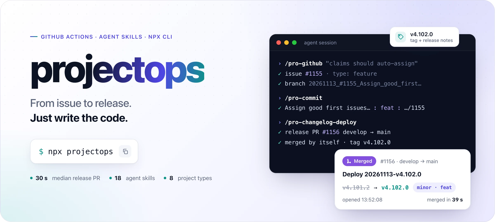
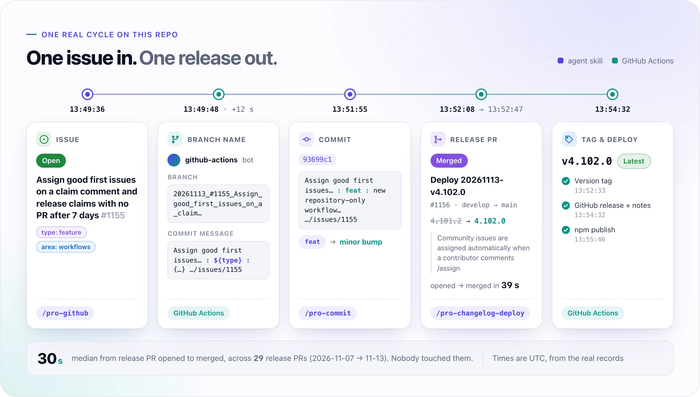
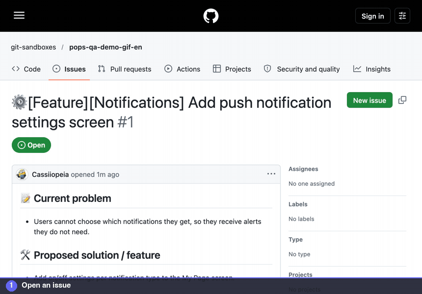
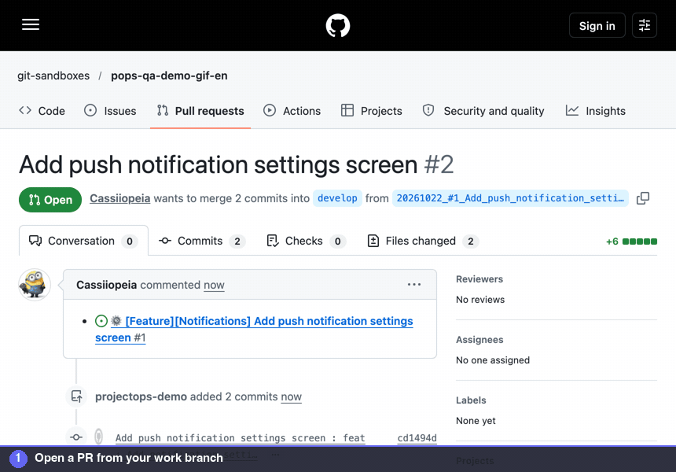
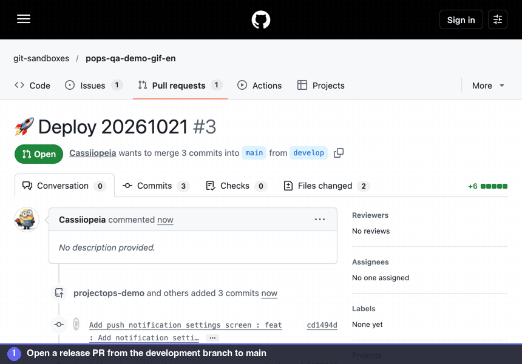
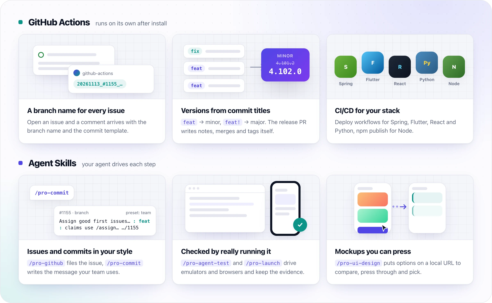
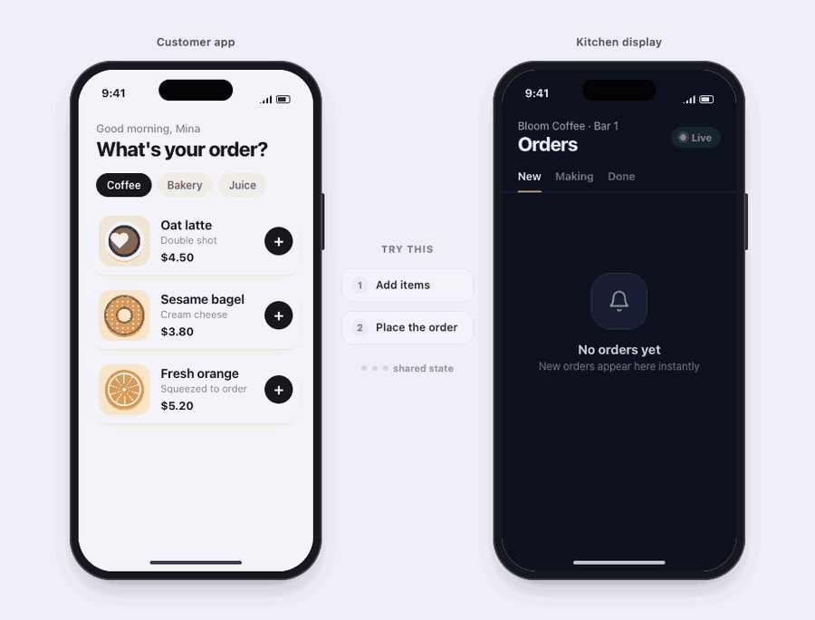
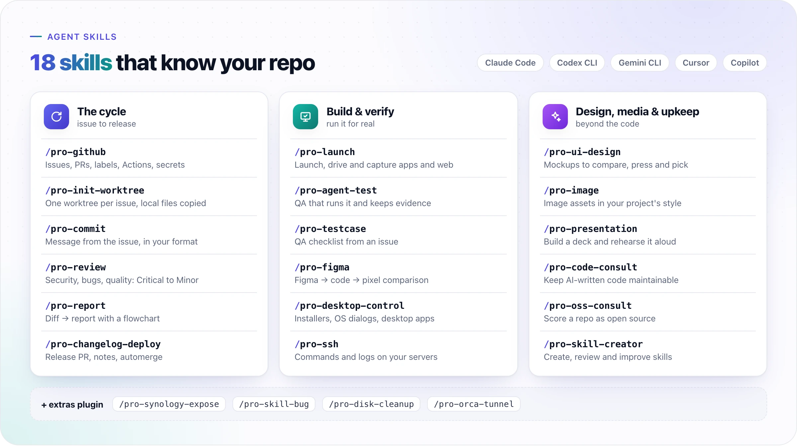

<!-- translated-from: README.md@f3a57d85 -->
<div align="center">

<picture>
  <source media="(prefers-color-scheme: dark)" srcset="https://raw.githubusercontent.com/Cassiiopeia/projectops/main/docs/images/readme-hero-dark.webp">
  
</picture>

**一次安装，从 Issue → 分支 → 发布 PR → 部署，每一步都有 Agent Skills 配合驱动。**

[한국어](README.ko.md) | [English](../../README.md) | **简体中文** | [日本語](README.ja.md)

[](https://www.npmjs.com/package/projectops) [](https://github.com/Cassiiopeia/projectops/releases) [](../../LICENSE) [](https://cassiiopeia.github.io/projectops/)

</div>

## 开始使用

```bash
npx projectops
```

| 我想要… | 运行 |
|---|---|
| 加入到现有项目 | `npx projectops`（交互式向导，无需事先安装） |
| 开始新项目 | 在 GitHub 上点击 **Use this template**（约 1 分钟自动配置） |
| 仅安装 Agent Skills | `npx projectops --mode skills` |
| 检查安装状态（只读） | `npx projectops --mode doctor` |

需要 Node.js 20.12+ 和 Git（Agent Skills 还需要 Python 3）。npm 的 `latest` 与 `main` 分支完全一致。全部选项：[CLI 参考](https://cassiiopeia.github.io/projectops/cli)（英文）。

<details>
<summary>观看向导运行（示例 Spring 项目的真实录制）</summary>


</details>

## 一个改动如何发布

<picture>
  <source media="(prefers-color-scheme: dark)" srcset="https://raw.githubusercontent.com/Cassiiopeia/projectops/main/docs/images/readme-cycle-dark.webp">
  
</picture>

上面每张卡片都是本仓库的真实记录。你打开一个 Issue（或由 `/pro-github` 创建），机器人评论分支名和提交模板；`/pro-commit` 写提交；`/pro-changelog-deploy` 打开发布 PR。发布 PR 根据提交标题决定版本（`feat` → minor），写好说明，自动合并并打标签。

**在本仓库实测。** 2026-11-07 至 2026-11-13 期间从 develop 向 main 打开的 29 个发布 PR，从打开到完成版本决定、CHANGELOG 与 README 更新、创建标签并合并，中位数为 **30 秒**（最快 25 秒，最慢 50 秒）。打开之后无人干预。自行验证：比较已合并发布 PR 的 `created_at` 和 `merged_at`（`GET /repos/Cassiiopeia/projectops/pulls?state=closed&base=main`）。

<details>
<summary>实际运行：Issue、PR 摘要和发布（在示例仓库录制，角落计时器为真实时间）</summary>

**打开 Issue**，带有分支名和提交模板的评论随即出现。



**打开 PR**，会发布根据提交生成的变更摘要，每次推送都会更新同一条评论。



**打开发布 PR**，会自动写说明、决定版本、合并并创建标签。



</details>

## 你能得到什么

<picture>
  <source media="(prefers-color-scheme: dark)" srcset="https://raw.githubusercontent.com/Cassiiopeia/projectops/main/docs/images/readme-features-dark.webp">
  
</picture>

| 传统方式 | 使用 projectops |
|---|---|
| 手动升级版本、打标签、写变更日志 | 发布 PR 根据提交标题决定版本，写说明并打标签 |
| 从零搭建 CI/CD | Spring、Flutter、React、Python、Node 工作流安装即用 |
| 每次手动整理 Issue 和提交信息格式 | `/pro-github` 和 `/pro-commit` 按团队格式撰写 |
| 每次代码审查和分析都要重新输入提示词 | 18 个 Skills 提供一致的结果，无需重复输入 |

**可以点击的设计稿。** `/pro-ui-design` 用仓库的设计令牌和字体制作设计稿，并在本地地址上展示。下面的例子中两个画面共享同一状态：左侧下单后，订单立即出现在右侧的厨房画面。同一次运行还可以把这个 GIF 发布到 Issue。



## Agent Skills

<picture>
  <source media="(prefers-color-scheme: dark)" srcset="https://raw.githubusercontent.com/Cassiiopeia/projectops/main/docs/images/readme-skills-dark.webp">
  
</picture>

**Agent Skills**（18 个）可在 Claude Code、Codex CLI、Gemini CLI、Cursor、GitHub Copilot 中运行，并按你的风格书写（`~/.projectops/config/config.json`，见 [Skills 指南](https://cassiiopeia.github.io/projectops/skills)（英文））。设计、规划与实现交给 `superpowers`（brainstorming → writing-plans → executing-plans）。

<details>
<summary>查看全部 18 个 Agent Skills 及安装方法</summary>

| 分组 | 技能 | 用途 |
|---|---|---|
| 周期 | `/pro-github` | Issue（一句话 → 模板）、PR、标签、评论、仓库浏览、Actions 与 Secret |
| 周期 | `/pro-init-worktree` | 创建 Git worktree 并复制所需的本地文件 |
| 周期 | `/pro-commit` | 根据 Issue 上下文按你的格式完成提交信息（预设或模板） |
| 周期 | `/pro-review` | 从 6 个角度审查，按 Critical / Major / Minor 分类 |
| 周期 | `/pro-report` | git diff → 带流程图的实现报告，以评论发布 |
| 周期 | `/pro-changelog-deploy` | 推送 develop → 向 main 的发布 PR + 发布说明 + 自动合并 |
| 构建与验证 | `/pro-launch` | 启动、操作、截图应用、网页与服务器；模拟空列表和失败响应 |
| 构建与验证 | `/pro-agent-test` | 真正运行应用的 QA，报告复现步骤、证据与严重程度 |
| 构建与验证 | `/pro-testcase` | Issue → QA 检查清单 |
| 构建与验证 | `/pro-figma` | Figma 设计 → 代码 → 像素比对 |
| 构建与验证 | `/pro-desktop-control` | 安装向导、系统对话框、桌面应用的操作，安装前先确认 |
| 构建与验证 | `/pro-ssh` | 通过 SSH 在服务器上执行命令（EC2、群晖 NAS、Linux） |
| 设计与维护 | `/pro-ui-design` | 在本地地址比较、点击、挑选的设计稿，或给设计师的需求单 |
| 设计与维护 | `/pro-image` | 符合项目画风的图片素材，真正的透明背景 |
| 设计与维护 | `/pro-presentation` | 制作 HTML 演示稿，出声排练与指导，导出 PDF 和 PPT |
| 设计与维护 | `/pro-code-consult` | 按你的编码规范让 AI 写的代码保持可维护 |
| 设计与维护 | `/pro-oss-consult` | 以开源项目标准为仓库打分，只修改你批准的内容 |
| 设计与维护 | `/pro-skill-creator` | 创建、审查、改进技能 |

**Extras**（可选插件）：`/pro-synology-expose`、`/pro-skill-bug`（在任意会话中报告疑似技能缺陷）、`/pro-disk-cleanup`（安全清理磁盘空间）、`/pro-orca-tunnel`（按需提供 Orca Web 公网地址）。安装：`claude plugin install projectops-extras@projectops-marketplace --scope user`

```bash
# Claude Code
claude plugin marketplace add Cassiiopeia/projectops
claude plugin install projectops@projectops-marketplace --scope user
# Gemini CLI
gemini extensions install https://github.com/Cassiiopeia/projectops
# Codex CLI (macOS / Linux)
codex plugin marketplace add Cassiiopeia/projectops
# Cursor、GitHub Copilot 和完整菜单
npx projectops --mode skills
```

</details>

## 与其他工具对比

如果你只需要其中一部分，更小的工具可能更合适（[完整对比](https://cassiiopeia.github.io/projectops/compare)，英文）。

| | projectops | release-please | semantic-release | changesets |
|---|---|---|---|---|
| 版本依据 | 提交标题 | Conventional Commits | Conventional Commits | changeset 文件 |
| 发布步骤 | 发布 PR，自动合并 | 需手动合并的发布 PR | 推送即发布 | "Version Packages" PR |
| 按项目类型的 CI/CD | 有 | 无 | 无 | 无 |
| 驱动完整周期的 Agent Skills | 有 | 无 | 无 | 无 |
| 向仓库添加的内容 | 约 60 个文件 | 工作流 + 配置 | 配置 + CI 步骤 | `.changeset/` + CI 步骤 |

## 不适合的情况

- **仅支持 GitHub。** 依赖 GitHub Actions 以及 Issue 和 PR。
- **两个分支。** 发布从开发分支到默认分支（名称可在 `version.yml` 中修改）。
- **约 60 个文件**会加入你的仓库（工作流、辅助脚本、模板）。
- **发布频繁。** `latest` 跟随 `main`；`npx projectops@<version>` 只固定安装器，不固定工作流模板。
- **服务器部署假定有可通过 SSH 访问的 Docker 主机。** 个人访问令牌是可选的（[设置](https://cassiiopeia.github.io/projectops/getting-started)）。

支持的类型：`spring`、`flutter`、`react`（含 Next.js）、`node`、`python`、`react-native`、`react-native-expo`、`basic`。`@projectops server build`、`@projectops build app` 等评论命令：[PR Preview](https://cassiiopeia.github.io/projectops/pr-preview)、[Flutter 构建](https://cassiiopeia.github.io/projectops/flutter-test-build-trigger)、[Issue 自动化](https://cassiiopeia.github.io/projectops/issue-automation)。

## 社区

- **第一次贡献？** 选一个 [`good first issue`](https://github.com/Cassiiopeia/projectops/issues?q=is%3Aissue+is%3Aopen+label%3A%22good+first+issue%22)，单独一行评论 `/assign`，机器人会把它分配给你 7 天。
- [CONTRIBUTING.md](../../CONTRIBUTING.md) · [ARCHITECTURE.md](../../ARCHITECTURE.md) · [CODE_OF_CONDUCT.md](../../CODE_OF_CONDUCT.md) · [SECURITY.md](../../SECURITY.md)（请私下报告安全漏洞）
- 缺陷和需求请提 [Issues](https://github.com/Cassiiopeia/projectops/issues)，问题请到 [Discussions](https://github.com/Cassiiopeia/projectops/discussions)。完成的 Issue 会加上 `status: done` 标签，并在发布合并时关闭。

## 文档

全部内容见 **[文档站点](https://cassiiopeia.github.io/projectops/)**（英文和韩文）：[快速开始](https://cassiiopeia.github.io/projectops/getting-started) · [CLI](https://cassiiopeia.github.io/projectops/cli) · [Agent Skills](https://cassiiopeia.github.io/projectops/skills) · [版本管理](https://cassiiopeia.github.io/projectops/version-control) · [变更日志](https://cassiiopeia.github.io/projectops/changelog-automation) · [SSH + Docker 部署](https://cassiiopeia.github.io/projectops/ssh-docker-deployment-guide) · [Flutter CI/CD](https://cassiiopeia.github.io/projectops/flutter-cicd-overview) · [故障排查](https://cassiiopeia.github.io/projectops/troubleshooting)

完整版本历史：[CHANGELOG.md](../../CHANGELOG.md)

---

<div align="center">

**MIT License** · README 图片由 [`docs/recording/readme_assets/`](../recording/readme_assets/) 渲染生成

</div>
