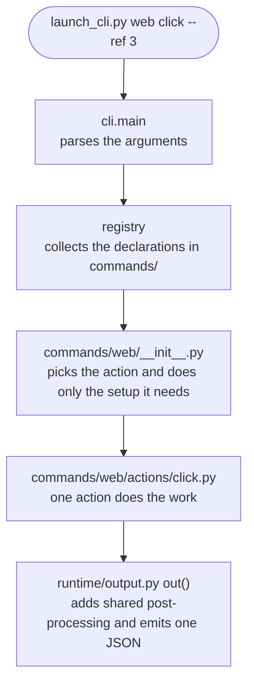

# pro-launch code map

> When to read: when you are about to change this skill's code for the first time and need to find **which file to open**.
> Steps and code examples for adding something new: `../../references/extending.md`. How to use the skill: `../../SKILL.md`.

`scripts/launch_cli.py` is only the entry point. The implementation lives in this package: **one subcommand = one module**.

## The path of one call



## Folders

```
scripts/
  launch_cli.py             entry point (thin)
  credentials.py            credential storage · masking
  knowledge.py              memory of what worked on this computer
  app_input.py              platform backends for app control (Android · iOS)
  maestro_session.py        resident iOS Maestro session — state file · client that calls the relay (#894)
  maestro_session_relay.py  the relay process (owns `maestro mcp` stdio · 127.0.0.1 TCP · idle shutdown)
  maestro_runs.py           records when pro-launch started Maestro · counts other runs (session-check) · per-computer start lock (#922)
  maestro_drivers.py        finds leftover Maestro iOS drivers · classifies them (session · orphan · active) · cleans up (#922)
  node_match.py            shared screen-element matching — exact > normalized (overlapping labels) > partial, text · desc · label (#927)
  knowledge_stale.py       stale-memory table (replacement marks · deleting test pollution) (#932)
  browser_pick.py           which browser to launch
  stealth.py                hides automation markers
  pro_launch/
    registry.py             Command · Action declarations and auto-discovery
    cli.py                  parser assembly · main()
    runtime/                lower layer — shared by the commands
      context.py            project root resolution · per-run markers
      output.py             out() — the single way to emit a result
      shots.py              capture location · names · shrinking
      envfile.py            writes env.sh (only here)
      devices.py            attached devices · role binding · selection
      creds.py              thin layer that gets saved credentials for commands
      browser.py            browser state file · Playwright setup · which browser
      procs.py              process checks · termination · listing · clipboard — the only place with OS branches
      foreground.py · crash_reports.py   foreground app check · reading crash reports (#923)
      device_claims.py · session_identity.py   device ownership records · global setting restore · session identity (#925)
      device_boot.py · android_device.py       booting · rebooting · waiting for readiness · host pressure fields (#924)
      app_identity.py       reads package and bundle IDs from project files (#932)
      arg_diagnosis.py      bad_args diagnosis — unknown names · similar names · that command's options · examples (#886)
      recent_roots.py       recently used project roots · candidates (when called outside a repo, #885)
      device_claims.py      device ownership · records of changed global settings (shared location on this computer, #925) · session_identity.py separates sessions
      device_boot.py        launching simulators and emulators · window mode (headless · small · normal)
      android_device.py     Android readiness · waiting · APK install · foreground.py foreground app · crash_reports.py iOS crash reports
      host_resources.py     host memory pressure · large processes · repos tied to running devices (#883)
      plugin_version.py     running projectops version (failure responses · doctor, once per process)
    commands/               upper layer — subcommands
      doctor.py detect.py output_path.py
      device/               __init__ dispatch · bindings.py (list · bind) · claims.py (claim · release) · boot.py (boot · reboot) · settings.py (locale · appearance)
                            action_options.py table of options each action accepts (unread options are bad_args, #972) — when an action reads a new option, add it to the table too
      http.py access.py db.py logs.py ssh.py cred.py local.py render.py shrink.py memory.py kb.py session_check.py
      app/                  __init__ dispatch · gestures.py (control) · app_control.py (device · package · tool runs) · steps.py (app run step files) · android_ime.py (Android input method switching · input check) · burst.py (burst capture) · launch_check.py (foreground check after launch) · actions/ (one action = one module)
      web/                  __init__ dispatch · options.py shared option table · session.py · targets.py · element.py target selection · watchdog.py time limits · request_capture.py request recording · saved_values.py secret storage · candidates.py candidates on failure · actions/
```

## Rules

There is no automatic check for these; keep them by hand when you change the structure.

| Rule | Why |
|---|---|
| `runtime/` does not import `commands/` | If the lower layer knows the upper layer, you get cycles, and you cannot tell which command breaks when shared code changes |
| Commands (modules · folders) do not import each other | Move anything two or more commands use down into `runtime/`. Then deleting one command does not break the others |
| `sys.platform` branches live only in `runtime/procs.py` | Scattered OS differences get tested only on the contributor's OS. In one place, you can fake the OS and test anywhere |
| Modules stay at or under 450 lines | One file was once 3,500 lines. Going over means it is time to split |
| `needs` sets an action's argument count | The dispatcher calls it as is, so a mismatch only blows up at runtime |
| The entry point stays under 80 lines | So the implementation does not pile up in the entry point again |

## What to change for what

| Goal | Where to change |
|---|---|
| A new subcommand | One module in `commands/` (`COMMANDS = [Command(...)]`) |
| A new `web` action | One module in `commands/web/actions/` (`ACTION = Action(...)`) |
| A new `app` action | One module in `commands/app/actions/` |
| A new app platform | One backend + registration in `scripts/app_input.py` |
| Rules for picking a browser | `scripts/browser_pick.py` (environment variable → bundled → installed) |
| Per-OS process handling (including background launch · group termination) | `runtime/procs.py` |
| Actions sent to the resident iOS session · fallback conditions | `IOSMaestroBackend._session_call` in `scripts/app_input.py` |
| Shared post-processing on every result | `out()` in `runtime/output.py` |
| Key order · trimming with `--brief` · `--fields` | `shape_payload()` in `runtime/output.py` (option extraction: `_pop_output_options` in `cli.py`) |
| Browser settings that live only while attached | `web_connect` in `commands/web/session.py` |
| Buttons a read-only session blocks | `commands/web/targets.py` |
| Shared options a `web` action accepts · per-action `--help` | The action's `Action(options=..., help=..., example=...)` · shared option table in `commands/web/options.py` |
| Finding the target · disabled state · read-only blocking | `locate_target` in `commands/web/element.py` |
| Default waits for actions (target 4 s · result 10 s) · turning timeouts into candidate failures | `*_wait_seconds` · `perform_on_target` in `commands/web/element.py` |
| Candidates and ranking attached on not-found · timeout | `commands/web/candidates.py` |
| Capture naming · size rules | `runtime/shots.py` |
| Subcommand order in help | `HELP_ORDER` in `cli.py` |

## Good to know

- **Output is always one JSON object.** Report a new failure with a new `code`. Do not change the meaning of an existing `code`:
  `pro-agent-test` · `pro-design-brief` call this skill as a subprocess and rely on those values.
- **State uses module globals.** These are `ROOT_CTX` · `ACCESS_CTX` · `MEMORY_CTX` · `MIGRATION` in `runtime/context.py`,
  and `cli.main()` clears them on every call. Do not use them to pass values between commands behind the scenes.
- **Tests patch the name where it is used.** To replace an `f` imported with `from x import f`, monkeypatch `f` in the importing module, not in `x`.
- **User-facing messages are currently Korean strings in the code.** Moving them into a message catalog is separate work on top of this structure
  (messages are grouped per command module, so they are easy to move).
