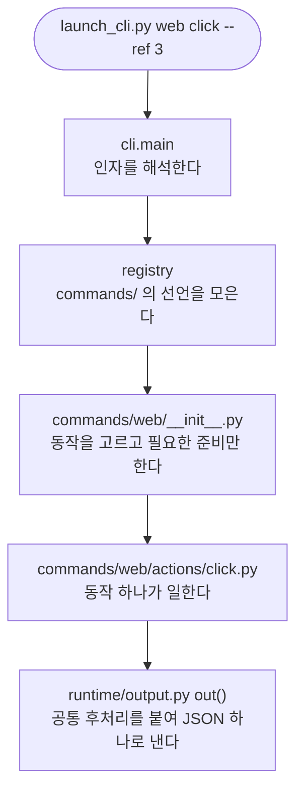

# pro-launch 코드 지도

> 언제 읽나: 이 스킬의 코드를 처음 고치려는 사람이 **어디를 열어야 하는지** 찾을 때.
> 새로 붙이는 법의 절차와 코드 예시는 `../../references/extending.md`, 쓰는 법은 `../../SKILL.md`.

`scripts/launch_cli.py` 는 진입점일 뿐이다. 구현은 이 패키지에 있고, **서브커맨드 하나 = 모듈 하나**다.

## 한 번의 호출이 가는 길



## 폴더

```
scripts/
  launch_cli.py             진입점 (얇다)
  credentials.py            자격증명 저장 · 마스킹
  knowledge.py              이 컴퓨터에서 먹힌 방식의 기억
  app_input.py              앱 조작 플랫폼 백엔드 (Android · iOS)
  browser_pick.py           어떤 브라우저로 띄울지
  stealth.py                자동화 표식 가리기
  pro_launch/
    registry.py             Command · Action 선언과 자동 발견
    cli.py                  파서 조립 · main()
    runtime/                아래층 — 명령들이 함께 쓰는 것
      context.py            프로젝트 루트 해석 · 한 실행의 표시들
      output.py             out() — 결과를 내는 단 하나의 길
      shots.py              캡처 자리 · 이름 · 줄이기
      envfile.py            env.sh 쓰기 (여기 하나뿐)
      devices.py            붙은 기기 · 역할 묶기 · 고르기
      creds.py              저장된 자격증명을 명령에서 꺼내는 얇은 층
      browser.py            브라우저 상태 파일 · Playwright 준비 · 어떤 브라우저
      procs.py              프로세스 확인 · 종료 — OS 분기는 여기만
    commands/               위층 — 서브커맨드
      doctor.py detect.py device.py output_path.py
      http.py access.py db.py logs.py ssh.py cred.py local.py render.py shrink.py memory.py
      app/                  __init__ 디스패치 · gestures.py · actions/ (동작 하나 = 모듈 하나)
      web/                  __init__ 디스패치 · session.py · targets.py · actions/
```

## 규칙 (테스트가 지킨다)

`tests/test_launch_architecture.py` 가 아래를 매번 검사한다. 어기면 CI 가 실패한다.

| 규칙 | 이유 |
|---|---|
| `runtime/` 은 `commands/` 를 import 하지 않는다 | 아래층이 위층을 알면 순환이 생기고, 공용 코드를 바꿀 때 어느 명령이 깨질지 알 수 없다 |
| 명령(모듈·폴더)끼리 import 하지 않는다 | 둘 이상이 쓰는 것은 `runtime/` 으로 내린다. 그래야 명령 하나를 지워도 다른 것이 안 깨진다 |
| `sys.platform` 분기는 `runtime/procs.py` 에만 둔다 | OS 차이가 흩어지면 기여자가 쓰는 OS 에서만 시험된다. 한 곳이면 OS 를 흉내 내 어디서나 시험한다 |
| 모듈은 450줄을 넘기지 않는다 | 원래 한 파일이 3,500줄이었다. 넘으면 나눌 때다 |
| 동작의 인자 수는 `needs` 가 정한다 | 디스패처가 그대로 부르므로 어긋나면 실행 중에야 터진다 |
| 진입점은 80줄 미만 | 구현이 다시 진입점에 쌓이지 않게 |

## 무엇을 하려면 어디를 고치나

| 하려는 것 | 고칠 곳 |
|---|---|
| 서브커맨드를 새로 | `commands/` 에 모듈 하나 (`COMMANDS = [Command(...)]`) |
| `web` 동작을 새로 | `commands/web/actions/` 에 모듈 하나 (`ACTION = Action(...)`) |
| `app` 동작을 새로 | `commands/app/actions/` 에 모듈 하나 |
| 새 앱 플랫폼 | `scripts/app_input.py` 에 백엔드 하나 + 등록 |
| 브라우저를 고르는 규칙 | `scripts/browser_pick.py` (환경변수 → 번들 → 설치된 것) |
| OS 마다 다른 프로세스 처리 | `runtime/procs.py` |
| 모든 결과에 붙는 공통 후처리 | `runtime/output.py` 의 `out()` |
| 붙어 있는 동안만 사는 브라우저 설정 | `commands/web/session.py` 의 `web_connect` |
| 읽기 전용 세션이 막을 버튼 | `commands/web/targets.py` |
| 캡처 이름 · 크기 규칙 | `runtime/shots.py` |
| 도움말에서 보이는 서브커맨드 순서 | `cli.py` 의 `HELP_ORDER` |

## 알아 둘 것

- **출력은 언제나 JSON 하나**다. 새 실패는 새 `code` 로 낸다. 기존 `code` 의 뜻을 바꾸지 않는다 —
  `pro-agent-test` · `pro-design-brief` 가 이 스킬을 서브프로세스로 부르며 그 값에 기대고 있다.
- **상태는 모듈 전역을 쓴다.** `runtime/context.py` 의 `ROOT_CTX` · `ACCESS_CTX` · `MEMORY_CTX` · `MIGRATION` 이 그것이고,
  `cli.main()` 이 호출마다 비운다. 명령 사이에 값을 몰래 넘기는 데 쓰지 않는다.
- **테스트는 쓰는 곳의 이름을 고친다.** `from x import f` 로 가져온 `f` 를 바꾸려면 `x` 가 아니라 가져온 모듈의 `f` 를 monkeypatch 한다.
- **사용자에게 보이는 문구는 지금 한국어로 코드에 있다.** 문구 카탈로그로 분리하는 것은 이 구조 위에서 별도로 할 일이다
  (명령 모듈별로 문구가 모여 있어 옮기기 쉬운 모양이 됐다).
