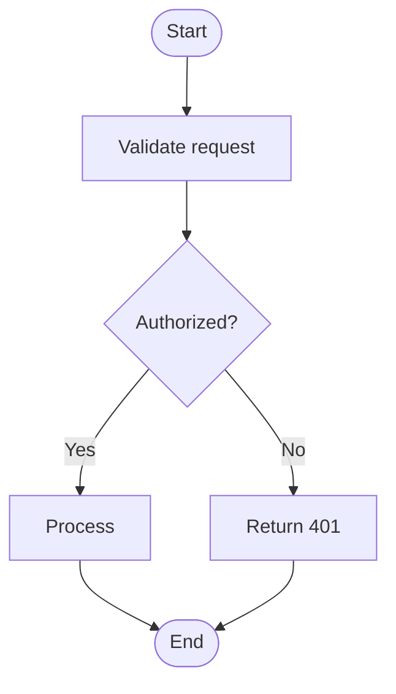

# Report output template · mermaid flowchart rules

> When to read: when you start writing the report body (output template), and when you decide whether to draw a flowchart or draw one.

## Output template

Write the headings and text in the output language (the `language` preference, else the repo's or user's language).
Keep the first line `<!-- projectops:report -->` exactly as is: `finish-issue` detects the report comment by this marker.
(For older reports without the marker it falls back to the Korean headings `## 개요` + `## 변경 사항`.)

```markdown
<!-- projectops:report -->
# [Issue title]

## Overview
[One-paragraph summary]

## Flow
[Only if you decided a flowchart is needed. Show the big picture first, then the detailed changes.]

## Changes

### [Category 1]
- `file/path`: [what changed]

### [Category 2]
- `file/path`: [what changed]

## Key implementation
[Core logic and approach]

## Caveats
[Notable points, future improvements]
```

## Is a flowchart needed?

Draw one if the change involves **multiple steps, branches, state transitions or several cooperating components**.
**Skip** it for simple changes (text edits, config values, logic inside one function). A meaningless diagram is noise.

| Draw a flowchart | Skip it |
|---|---|
| Multi-step pipeline such as request → validate → process → respond | Constant or wording change |
| Conditional branches (permission check, per-state handling) | Rename or reformat of one function |
| State transitions (waiting → running → done) | One-line config change |
| Flow across several files or services | Dependency version bump |

## Mermaid rules

GitHub issues, PRs and comments render ` ```mermaid ` code blocks directly. Follow these rules so they do not break.

````markdown
## Flow


````

- **[Important] Keep spaces, non-ASCII text and parentheses out of subgraph IDs**: if the `subgraph` identifier (ID) contains non-ASCII text (such as Korean), spaces or parentheses `()`, the GitHub renderer fails with `Unable to render rich display`. Always define the displayed text separately from the ID: `subgraph ID ["Displayed text"]`.
  * Wrong: `subgraph Create phase (create-issue)` (spaces and parentheses break rendering)
  * Right: `subgraph create_phase ["Create phase (create-issue)"]` (ASCII snake_case ID plus a bracketed label)
- **The code fence must be ` ```mermaid `**. `mermaidjs`, `mermaid-js` and similar do not render on GitHub.
- **[Readability] Always use `flowchart TD` (top to bottom)**: a horizontal flowchart (`flowchart LR`) forces endless horizontal scrolling on mobile or narrow viewports. Do not use horizontal layouts; use `flowchart TD`, flowing from top to bottom.
- Start/end: `(["text"])` (stadium). Process: `["text"]` (rectangle). Condition: `{"text?"}` (diamond).
- Branch labels: use the **pipe syntax `C -->|Yes| D`**. It is more stable than `-- Yes -->`, especially with non-ASCII labels.
- Always wrap node text that has non-ASCII or special characters in `["..."]`.
- **No `\n` in node text**: it shows as a literal `\n`. For a line break use `<br/>` as in `["Step 1<br/>Step 2"]`, or split the node.
- **No self-loops**: `A --> A` breaks rendering. Use a separate node such as "Retry" or "Wait".
- **No `curve: linear` config block**: arrows bend oddly.
- **Keep diamond text short** (3 to 5 words). Put details in branch labels or nearby nodes.
- Group complex flows with `subgraph`.
